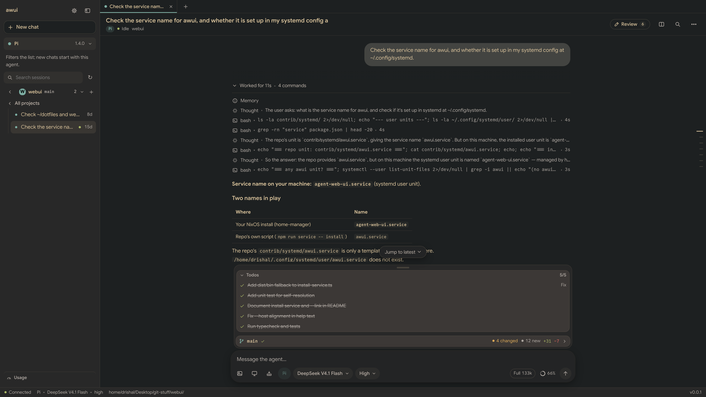

# awui

**awui** (agent web UI) is a local, private, responsive web UI for the **Pi**, **omp** (oh-my-pi), **Hermes** (hermes-agent), **Claude Code**, **OpenCode**, and **Grok Build** coding-agent harnesses — plus one read-only chat harness of its own, **Awui** (below). Use it from your desktop browser, through Tailscale Serve from your phone, or in a terminal with **atui**, its terminal client.

The browser is only a control surface. Each harness remains the agent and the source of truth for its own models, authentication, settings, tools, resources, trust decisions, and session files. This app never edits an existing session file and keeps no second transcript database; forks and handoffs only add new sessions in the harness's own store.

```
browser ──HTTP/SSE──▶ Node server (127.0.0.1:4783) ──▶ HarnessAdapter
                                                        ├─ Pi     (child process: `pi --mode rpc`, one per live chat)
                                                        ├─ omp    (child process: `omp --mode rpc-ui`, one per live chat)
                                                        ├─ Hermes (child process: `python -m tui_gateway.entry`, one per live chat)
                                                        ├─ Claude Code (child process: `claude -p` in stream-json mode, one per live chat)
                                                        ├─ OpenCode (one private `opencode serve` for every chat: its HTTP API and event stream)
                                                        ├─ Grok   (child process: `grok agent --no-leader stdio`, one per live chat)
                                                        ├─ Awui   (`pi --mode rpc`, read-only: the writing/executing tools denied)
                                                        └─ fake   (tests only)
```

**The Awui harness** is a chat surface in the harness dropdown, web UI only (atui omits it). For reading, asking, and computing, never editing the project: it is a `pi` child with pi's four writing/executing tools denied (`--exclude-tools bash,edit,write,powershell`), so a chat there can read, search the web, and use read-only MCP servers, but cannot edit files or run shell commands. Two awui extensions give it the chat-surface extras: `render_html` publishes a page (a chart, table, or mockup) into the thread — it writes only to awui's own render store, never the workspace — and [`eval_python`](extensions/eval-python.ts) runs a short snippet in a throwaway tmp dir (stateless, timeout-capped, output-bounded), so it can compute without touching the project. It keeps its own agent directory and per-project sessions under awui's state folder — never the user's `~/.pi/agent` — and declares no fork/rewind capability. Its sidebar shows a flat, dated chat history (Pinned, Today, Yesterday, each day this week, Older), Claude.ai-style, instead of projects; the project tree belongs to the coding harnesses. `Settings → Awui harness` edits the providers it can call (name, base URL, API kind, key — stored only in its own `models.json`, the key never shown back); the `litellm` provider is seeded from `~/.pi/agent/models.json` the first time and never overwritten after that.

## Screenshots



The start screen, a long session with its todo list and context ring, usage across chats, the
palette, the file viewer, the light theme, and the phone layout are in
[docs/screenshots/](docs/screenshots) — taken from real sessions with the Pi harness.

## Install and run

### Install

A self-contained `awui` binary runs the whole thing with no Node on the machine — the server, the web bundle, and the harness extensions are all embedded:

```bash
curl -fsSL https://github.com/drishal/agent-web-ui/releases/latest/download/awui-linux-x64 -o ~/.local/bin/awui
chmod +x ~/.local/bin/awui
awui                 # web UI + API on http://127.0.0.1:4783
awui install tui     # also drop the atui terminal client on your PATH (~/.local/bin/atui)
awui doctor          # check the setup (config, harnesses, state folder, port); --json for machines
awui tern            # in a Tern pane: awui drawn natively by Tern (after awui install tui)
```

State goes to `$XDG_STATE_HOME/awui` as usual, so a binary and a source run share one config and one set of sessions.

Build it yourself from a clone (inside `devenv shell`; see below): `bun run scripts/build-binary.ts` writes `dist/bin/<platform>/awui`. `scripts/build-binary.ts --all` cross-compiles every target.

`awui install service` puts the binary at `~/.local/bin/awui` and writes a systemd user unit, `~/.config/systemd/user/awui.service`, that runs it and starts with your session; a leftover `agent-web-ui.service` from before the rename is retired first, so the two never share the port. Add `--link` to symlink the binary instead of copying it — what a dev checkout wants, so a rebuild is live after `systemctl --user restart awui`. Running `bin/awui install service --link` from a checkout installs the binary the build wrote, not the node running the script.

### From source

Requirements: Node ≥ 22.19 (24 LTS recommended), npm, and `pi`, `omp`, `hermes`, `claude`, `opencode`, and/or `grok` installed and logged in. A missing harness shows as unavailable instead of crashing the app.

```bash
git clone https://github.com/drishal/agent-web-ui.git
cd agent-web-ui
npm run build:binary
cp dist/bin/linux-x64/awui ~/.local/bin/awui
awui                 # serves UI + API on http://127.0.0.1:4783
```

`npm link` puts `awui` (the server) and `atui` (the terminal client) on your PATH.

Open http://127.0.0.1:4783/ on this machine. No token and no sign-in: local use is open.

Settings live in `~/.config/awui/`: `config.yml` (start from [`config.example.yml`](config.example.yml)) and, optionally, a base16 `theme.yml`. To use it from other devices (LAN and/or Tailscale Serve), set:

```yaml
host: 0.0.0.0          # prints LAN: http://<ip>:4783/ for each address
auth:
  username: you
  password: your-password
```

then restart. Other devices get a sign-in form; this machine still opens directly. If you would rather not keep the password in a file, leave it out and run `npm run set-password` instead (it stores only a scrypt hash).

| Script | What it does |
|---|---|
| `npm run dev` | Backend under `tsx watch` plus Vite on :5173, proxying `/api`. Prints a `Dev UI: http://127.0.0.1:5173/` link. |
| `npm run set-password` | Alternative to `auth.password`: sets the login for other devices, storing a salted scrypt hash only. Changing it signs every device out. |
| `npm run typecheck` | Strict TypeScript for server, web, and tests |
| `npm test` | Vitest unit and integration tests. Uses only fake and scripted harnesses, so no model tokens are spent. |
| `npm run test:e2e` | Builds, then runs Playwright (Chromium) against the fake harnesses |
| `npm run smoke` | Opt-in checks against the real installed Pi, omp, Hermes, Claude Code, and Grok Build (see [Testing](#testing)) |
| `npm run build` / `npm start` | Production build, then a single process serving UI and API |
| `bun run scripts/build-binary.ts` | Compile the self-contained binary into `dist/bin/<platform>` (`--all` for every target). Run inside `devenv shell`. |

### Developer environment

`devenv` gives the pinned toolchain (Node 22, the nixpkgs `bun` the binary build needs, the e2e browsers): `devenv shell` enters it, `devenv tasks run awui:binary` builds the binary, `devenv up` runs `npm run dev` as a process. The nixpkgs-built bun inside the shell is what makes the compiled binary run on this machine (the upstream bun binary segfaults here); build binaries only inside the shell.

### Configuration (`~/.config/awui`)

**`config.yml`** (YAML, so it can carry comments; every key optional). It is read at startup; `theme`, `text_scale`, `chat_width`, `density`, `autocollapse_sidebar`, `show_status_bar`, and `herdr` are re-read on every page load. An unknown key or a wrong type stops the server with the key named (exit 78, which the autostart unit does not retry), rather than being guessed at.

The **Settings** dialog (gear left of the collapse button) edits the same file: the shared look (theme, chat text size, chat width, density), pairing and sign-out, and every key below but `harnesses`. The server checks a save exactly as startup checks the file, so it can never leave a server that will not start; port, host, login, roots, and allowed hosts/users wait for a restart (with a Restart button when systemd supervises). Any signed-in device may change them, except a change that would shut that device out once it applies (a LAN phone switching `host` to `127.0.0.1`, a Tailscale Serve device dropping its own host name or login from the allow lists): that one is refused and has to be made on the machine running the server. A setting an environment variable overrides is shown as such and cannot be changed from the file.

| Key | Default | Meaning |
|---|---|---|
| `port` | `4783` | 1024–65535. |
| `host` | `127.0.0.1` | `127.0.0.1` (this machine only, no sign-in) or `0.0.0.0` (LAN; other devices sign in). Nothing else is accepted. |
| `auth.username`, `auth.password` | — | Login for other devices. `host: 0.0.0.0` and `allowed_hosts` need a login (this or `set-password`), otherwise the server refuses to start. A `config.yml` holding a password is kept at mode 0600, and the password never enters the server's environment, so the agents' shells never see it. |
| `workspace_roots` | home dir | Projects must be inside a root, checked by realpath, so symlink and `..` escapes are refused. |
| `allowed_hosts` | — | Extra `Host` values (e.g. your `*.ts.net` Serve name). |
| `allowed_tailscale_users` | — | Optional Tailscale logins; when set, Serve requests must also carry one of them. |
| `theme` | — | Shared look on every device: `system`, `light`, `dark`, or `base16` (`theme.yml`; `custom` is accepted as the old name). Unset: `theme.yml` when there is one, else `system`. |
| `text_scale` | `1` | Shared chat text size (a scale on the 14.5px base, 0.5–2). |
| `chat_width` | `comfortable` | How wide the conversation and composer run: `comfortable` (960 px), `wide` (1400 px), or `full` (the whole pane). Review drawers keep their own width. |
| `density` | `comfortable` | How tight the web UI sits: `comfortable` (the default look) or `compact` (tighter sidebar rows, turn gaps, tool rows, composer, and tab strip). Phones keep their comfortable touch sizes. |
| `autocollapse_sidebar` | `true` | Fold the sidebar away below 1200 px wide (phones use the drawer anyway); a sidebar collapsed with its button stays collapsed at any width. |
| `show_status_bar` | `true` | Show the bar under the conversation (connection, harness, model, folder, version); `false` hides it, as phones do already. |
| `herdr` | `true` | Work with [herdr](#with-herdr): mark the sessions open in its panes (and show one there rather than start a second harness on it), and let atui in a herdr pane report its chats. Nothing happens where herdr does not run. |
| `herdr_socket` | herdr's default session's | herdr's API socket (`~/` is expanded), for a named herdr session: `~/.config/herdr/sessions/<name>/herdr.sock`. File-only, read at startup. |
| `harnesses.<pi\|omp\|claude\|hermes\|opencode\|grok>.command` | the name on `PATH` | The harness's executable (`~/` is expanded), e.g. a dev build. The Awui harness runs Pi's. |
| `harnesses.<pi\|omp\|claude\|grok>.args` | — | Arguments added to each chat's command line, before the ones awui must set last (`--session-dir`, `--cwd`, `--resume`): `[--add-dir, /srv/docs]` for Claude Code, or `[--allow-dangerously-skip-permissions]` to offer its Bypass mode in the permission picker. For Grok they go before the mode name `stdio`. Model probes and listings do not get them, and the Awui harness never does (they could loosen its read-only lock). Hermes and OpenCode take no `args`: Hermes's chats run its gateway from its Python package, and OpenCode's share one server. This block is file-only, read at startup: the Settings dialog does not show it, because a command is a program the server runs and any signed-in device can save settings. |

**`theme.yml`**: a base16/base24 scheme (see [Theme](#theme)); the dotfiles' stylix module writes it.

**Environment variables** win over `config.yml`, for services and tests:

| Variable | Meaning |
|---|---|
| `PORT`, `HOST`, `AUTH_USERNAME`, `AUTH_PASSWORD` | As the keys above. |
| `WORKSPACE_ROOTS`, `ALLOWED_HOSTS`, `ALLOWED_TAILSCALE_USERS` | As the lists above (`:`-separated roots, comma-separated hosts and users). |
| `AWUI_CONFIG_DIR` | Another settings folder; empty ignores `config.yml` (the tests do this). |
| `AWUI_HARNESSES` | Comma list of harness adapters to enable; default `pi,omp,hermes,claude,opencode,grok,awui` (the tests use `fake`). |
| `PI_BIN`, `OMP_BIN`, `HERMES_BIN`, `CLAUDE_BIN`, `OPENCODE_BIN`, `GROK_BIN` | A harness's executable, over `harnesses.<id>.command`; default its name on `PATH`. |
| `AWUI_HERDR` | `1` or `0`: over `herdr`. |
| `HERDR_SOCKET_PATH` | Set by herdr in its panes: a server started in one asks that herdr session (over `herdr_socket`). The server keeps herdr's pane variables from its harness children, so their own herdr hooks do not claim its pane. |
| `AWUI_WEB_DIR` | Serve the built UI from here instead of `dist/web`. |
| `AWUI_HEARTBEAT_MS` | Keep-alive interval for open event streams; default `20000`. |
| `THEME_FILE` | Another theme file. |
| `AUTH_CREDENTIALS_FILE` | Login written by `npm run set-password` (default `$XDG_STATE_HOME/awui/credentials.json`); used when no password is configured. |
| `OMP_AGENT_DIR`, `OMP_SESSION_DIR` | Overrides for omp only (see [Config dirs](#config-dirs)). |
| `XDG_STATE_HOME` | The cookie-signing secret lives in `awui/cookie-secret` (mode 0600). |

## Using it

- **Sidebar.** New chat comes first, then the harness row. New chat never creates a chat: it shows the main pane's **start screen** (see *New chat*) with the folder picker open over it, so it works before any folder is chosen; the harness row under it filters the session list to one harness and picks the agent for new chats (a caption says so). Below them sit session search and the sessions. The sidebar focuses the current folder (Hermes Desktop's one-folder view): its name and count on top (its **+** starts a chat there, the row's ⌄ switches to another project without leaving the view), an **‹ All projects** row to go back (the list slides in the direction you went; reduced motion just changes it), then that folder's sessions of the selected harness, most recent first in date groups. *All projects* shows every folder, grouped by project and ordered like Hermes Desktop: sessions by their last activity (their last turn, else when they began; only opening one does not move it), projects by their newest session, and a git repository's projects together (the one you are in, then the one on `main`/`master`, then the other branches and worktrees, each naming its branch). Inside a project, the run of what you did last has no heading (cut at a real pause of half an hour or more, about five sessions down); below it come calendar headings (Yesterday, Earlier this week, Last week, Earlier this month, then months, with the week starting on your locale's day), never one above the first row, and *Show N more in …*. Drag a session (or **Move up** / **Move down** in its menu, or **Alt+↑/↓**) to a new place inside its heading; the order is kept per project and harness for every device (`$XDG_STATE_HOME/awui/session-order.json`), and a session that sees new activity still goes back to the top. Under the search box, **Running**, **Needs you**, and **Today** chips (one on at a time, each with its count; Running and Needs you appear only while something matches) narrow the list to the chats working now, the ones waiting on an answer or an approval, or the ones with activity since midnight; they combine with the text search, the choice is remembered per device, an empty result offers **Clear filter**, and Escape in the search box clears the text, then the filter. Search covers all projects and the selected harness's sessions; a dot on each row marks its harness (the harness menu, which scopes the list and picks the harness for new chats, is the legend), and a spinning ring marks a session that is working. Clicking a session in another project switches to that project, and a project row's **+** switches the folder to that project and shows the start screen for it. Each folder carries a badge — its monogram (its first letter, in a hue taken from its name) until you set an icon for it (one or two characters) from the folder's menu on this device. Only folders inside `WORKSPACE_ROOTS` that the harness can open are listed. A green dot means the session is already open in this server; clicking it attaches to that chat rather than opening a second writer. A row's **⋯** (or a right-click, or a long press on a phone) **pins** it to a *Pinned* list at the top or **archives** it out of the list; *Show N archived* at the bottom brings archived ones back in place, and a search finds both. The same menu marks a session **unread** (an accent dot beside its title until it is opened here, kept by the server like every other mark) or **Select sessions** starts a selection: click rows to pick them, Shift extends the run from the anchor, Escape leaves, and the bar over the list settles, archives, pins, or snoozes an hour for all of them (one toast, one undo) or **settles** it (done for now: it leaves the list until a run starts in it again) or **snoozes** it for an hour, until tomorrow at 9:00, until next Monday, until a time you pick, or until the account's limit resets (it comes back then, or as soon as it fails or asks for something); *N snoozed* and *N settled* at the bottom bring them back in place, and every one of these changes shows a toast with **Undo** (or **Ctrl+Z** outside a text field). Resting the mouse on a row (T3 Code's hover card) shows its last prompt and the start of the answer, the model, how many turns, and the files it changed, read without opening the session. Above the projects (T3 Code's inbox), **Needs you** lists chats waiting on an answer or an approval and **Working** (folded by default) the chats that are running; the chat on screen stays where it is. Marks are kept by the server in `$XDG_STATE_HOME/awui/session-marks.json`, so every device sees them; the harness's session files are not touched. The gear left of the collapse button opens **Settings**: pairing and sign-out for this device, and the server's `config.yml` — including the shared theme and chat **text size** (scales the conversation and composer on every device). Drag the sidebar's right edge to resize it (200–560 px, remembered per device). The panel button at its top right folds it away, and the chat header gets one to bring it back. Narrower than 1200 px (a vertical monitor, a tiled half screen) it folds away by itself and returns when the window widens (`autocollapse_sidebar`); reopened by hand it stays open until the width crosses back, and one you collapsed yourself stays collapsed at any width. The handle also takes arrow keys (Shift for bigger steps) and Home/End, and double-clicking resets it.
- **Tabs** (Hermes Desktop's). The chats open in this browser sit in a strip above the conversation, each in its harness's colour with its title; a working ring marks one that is running, and a dot one that finished while another was shown. Clicking a session in the sidebar shows it in the current tab, or switches to its tab when it is already open; **Ctrl/⌘-click**, **middle-click**, or **Open in new tab** in the row's ⋯ menu (or right-click) opens it in a new tab, as does **+**, which puts a tab on its own with the start screen — the first prompt fills that tab. A session shows the moment it is clicked: its tab, title, and harness come up at once over a loading screen (a ghost of the thread in the harness's colour) that fades when the conversation has drawn. The fetch starts early (on hover for a chat the server holds, on the mouse press for one it resumes), and a long chat draws its last few turns first and fills in the older ones above them, out of sight. Closing a tab (its ✕, middle-click, or Delete) only hides it: a run keeps going on the server. ←/→, Home/End, and Enter move through the strip; the browser keeps Ctrl+T/W/Tab. **Drag a tab sideways** to reorder the strip (a few pixels of slack keep a click a click; the others slide aside), or press **Alt+Shift+←/→** on the focused tab. **Pin tab** in a tab's right-click menu (or the palette) moves it to the left, narrow, with just its harness dot and a short title: a pinned tab has no ✕ and is not closed by middle-click or Delete until you unpin it, and a drag or key move never carries a tab across the line between the pinned and the rest. **Ctrl+[** and **Ctrl+]** go back and forward through the chats you have shown, **Alt+Shift+T** reopens the last closed tab (the browser keeps Ctrl+Shift+T), and **Ctrl+Alt+Enter** in the composer sends, then opens a new chat in a new tab. Tabs, their order, and their pins are remembered per device: after a reload, or a server restart, each one reattaches to its chat or resumes its session when you open it. On a phone the strip gives way to an *Open tabs* list at the top of the drawer.
- **Harness menu.** One row under *New chat* shows the current harness and its version, short and comparable (`1.0.2`, `2026.9.24`: a build that reports a placeholder `0.0.0`, as Hermes on Nix does, shows its release date instead), with the CLI's full version line on hover; its menu lists every harness (Pi, omp, Hermes, Claude Code, OpenCode, and whatever else is registered), each in its own colour, and keeps an unavailable one listed, greyed, with the reason. Arrow keys, Enter, and Escape work. Picking one scopes the sidebar to that harness's own sessions and picks the harness for new and resumed chats; open chats stay on the harness that created them. A harness's colour is a theme token it declares (`accent`), or the first one free, so a new adapter needs no CSS. The composer's harness chip uses the same menu to hand a chat off, and the start screen's agent chip uses it to pick the agent for the chat to come.
- **Project.** The start screen's folder chip picks the folder: its menu lists the recent folders (newest first), then *Choose another folder…* for the browser — which walks `WORKSPACE_ROOTS` one level at a time, or takes a typed path. With no folder chosen the chip stands out and Enter in the box opens the browser, keeping whatever was typed.
- **New chat.** With no chat on screen, the main pane is a start screen: one question ("What should {agent} do in {folder}?"), a text box, and the agent and folder chips under it. Images go in the box as in a chat's composer (paste, drop, or the image button) and are sent with the first message. Typing a message and pressing Enter creates the chat and sends it — nothing starts until then. With no folder chosen, Enter opens the folder picker and keeps the draft; pressing Enter again sends. The Awui harness asks anything and has no folder chip. *New chat* everywhere (the sidebar, the tab strip's +, the palette, a project's +, the installed app's shortcut) shows the start screen, keeping any open chats' tabs; the sidebar's *New chat* also opens the folder picker over it (Escape keeps the current folder, and a picked one puts the cursor in the box).
- **Each turn** shows:
  - your prompt as a bubble;
  - under it, faint (45%) until the turn is hovered or has focus, and full on the latest turn (Claude's chat; always full on touch screens and under reduced motion, and a long press on the message opens them as a sheet): when it was sent (the clock time, "Mon 3:41 pm" within a week, "Oct 12, 3:41 pm" before that, the full date on hover), **Retry**, **Edit**, **Copy**, and **Copy prompt link** (see *Prompt links* below). Retry runs the prompt again, with its images; Edit opens it in place (Ctrl/⌘+Enter sends, Esc cancels) and, when the turn has a file checkpoint, can undo its file changes first. Hermes, Pi, omp, and OpenCode replace the message in the same session; OpenCode reverts the session to before it (its own revert, the conversation only: the files stay as they are, for the checkpoint to undo) and then sends. Hermes does it as Hermes Desktop does (`prompt.submit` cutting at the message's stored row, which Hermes soft-archives rather than deletes). Pi and omp can only do it from an extension (their RPC `fork` and `branch` start a new session), so the server starts them with [`extensions/rewind-to.ts`](extensions/rewind-to.ts) (`-e`): Edit and Retry run `/rewind-to <n>`, check the session went back, then send the prompt; what followed stays in the session as a side branch (`/tree` reaches it), and the command is kept out of the composer's "/" menu. In a terminal, `/rewind-to` alone picks the prompt from a list. Claude Code keeps a session's past as it is, so there both run in a branch from before the message, on the same model, thinking level, and permission mode: a fork, or a fresh chat for the first message; the original chat stays in the sidebar.
  - one **tool card** folding the agent's thinking, tool calls, and approvals (open while running, collapsed after, and left open when a call failed). Its header is the **"Worked for 12s · Used 6 tools"** line with a stack of icons for the kinds of tool used (an MCP server is a kind of its own, drawn as a monogram), the turn's `+42 −7`, and, when a call failed, a **"1 failed"** button that opens the card and goes to the first failed row. Each call is a row of icon, sentence, facts, and a status mark in one column (a spinner, a check that draws itself when the call settles in view, or a red mark); a failed row is tinted and carries its error line under it. On the latest turn a failed row also has **Ask to retry**: awui never runs a harness's tools itself, so it sends the agent a message naming the call and its error ("Retry the failed tool call (running npm run e2e). It failed with: …") as the next prompt, or queues it as a follow-up while the agent works where the harness takes them, and disabled where it does not. On a phone the facts sit under the sentence. While a run goes, the header names what it is doing instead of "Working": *Thinking*, then the running call's own sentence (*Running npm test*), then *Writing* once the answer streams (real states only, never a timer; a change waits 600 ms behind the last so a burst of fast calls does not flicker, and the label is a polite live region), and settles on *Worked for 12s*. What the agent writes to you between tool calls is a reply, shown as one and in order, not folded away: *reply, run a command, then answer* reads as the reply, the command's fold ("1 command"), and the answer, the same while it runs and after. Only the stretches of work fold, and a stretch that is only thinking shows its thought row. Work the agent does after writing its answer (a todo update, a rendered page, a memory note) keeps its place below the reply, as its own fold, instead of jumping into the fold above it. Each tool call reads as a sentence (*Reading src/app.ts* while it runs, *Read src/app.ts · 412 lines* after, *Couldn't run npm test* when it fails; `tool-sentence.ts`), with a count only where the call's own result holds one, so a call it cannot read shows just its time. Where an output is a shape the app is sure of, its summary is read instead of counted (`tool-facts.ts`): a Vitest, Jest, pytest, cargo, or go test run (*25 passed · 1 failed*, and which test), tsc and eslint (*3 errors in 2 files*), rg and grep (*4 results in 2 files*), `git status` and `git diff --stat`, npm, pnpm, and pip installs, and a JSON array (*12 items*); an output no parser is sure of is never guessed at. A card of more than 8 calls shows the first 3, a **Show N more calls** button, and the last 2 (a running or failed call is never hidden, and Find in chat opens the rest). A tool call that runs past 1.5 s shows its time after its line, counting while it runs and kept once it is done; a call with output has **Full output** under it, opening all the server kept (16 KB) in a sheet that follows the call while it streams, with Copy, and a call whose result never comes (a cancelled question) stops when the run does and says it got no result;
  - an **answered request** (Approve, Deny, a chosen option) does not just vanish: its card fades and blurs while its height glides down to one quiet line above the composer, "Approved: Allow tool: read", with a check or a cross that draws itself; the line leaves by itself, and the request row in the turn keeps the record. Reduced motion shows the line at once;
  - a **queued message** (a follow-up or steer waiting above the composer) glides from its row into the prompt it becomes when the agent takes it, and the prompt lights up softly as it lands; the status stack grows to its content instead of appearing at full height. Reduced motion skips the glide and the light;
  - a **plan** the agent handed over for review (Claude Code's `ExitPlanMode`, [pi-plan-mode](https://www.npmjs.com/package/@narumitw/pi-plan-mode)'s `plan_mode_complete`) as a card (T3 Code's): the plan as Markdown, its first lines until *Show the whole plan*. On the latest turn, with the agent idle and nothing asked, **Implement** sends "Implement the plan." and **Revise** starts a message about it; while the harness itself asks about the plan (Claude's approval, pi-plan-mode's review menu), its question above the composer is the way to answer;
  - **Code blocks** have a slim header with the language ("TypeScript", "bash"; none for an unlabeled block), **Wrap** (wrap long lines or scroll them sideways, one choice per device) and Copy on hover. In a finished answer a block of a language the file viewer knows is coloured, and one of six lines or more has line numbers (never selected or copied); a block past 2000 lines or 100 KB stays plain, and a streaming answer's blocks stay plain until it settles. A one-line shell block (`bash`, `sh`, `zsh`, `fish`, `console`) in a finished answer also has **Run**, which runs it in the chat's project folder with that shell (60 s limit, output kept to 100 kB) and shows the exit code and output under it, with Copy and *Add to message*. Any signed-in device can do this, as it can already ask the agent to; the server logs that a command ran, not the command.
  - the answer as plain text with a Copy button (every copy button, in code blocks, the file viewer, output sheets, and the pair dialog too, is one component: the icon blurs into a check and its name turns to "Copied", "Link copied", or "Turn copied" for a moment, announced politely, "Copy failed" when refused; the row under an answer is faint like the prompt's, and Retry's arrow turns once on a press); on hover (or keyboard focus) its row also says how the turn went, "24s · first token 1.2s" (the turn's time, and the wait for the model's first words), each part only when the harness reported what it needs; the per-turn token rate is left out because no harness reports output tokens per message (the session's average is in the context ring). A phone shows it in the long-press sheet's title and always on the row; **Timing** (a clock button beside Copy, and in the phone's sheet) opens the turn as a waterfall: every thought, reply, tool call, and subagent as a bar on a time axis from the prompt to the settle (ticks at round values), the slowest call marked, a subagent call's runs folded under it, each row named for a screen reader ("Ran npm test, 0.4 s to 38.2 s, slowest call") and moved through with the arrow keys; tokens and cost appear only on subagent runs, the one place the harness reports them, and a turn with no times says so; **Copy turn as Markdown** (beside Copy, and in the phone's sheet) puts the whole turn on the clipboard for an issue or a PR: `## Prompt`, `## Work` (a line per tool call, like `- **Edit** \`src/app.ts\` (+12 −3)` or `- **Run** \`npm test\` (failed)`, with the agent's replies between them), and `## Answer`; no diffs, tool output, or thinking, and cut at 200 KB (Export as Markdown in the chat menu keeps the diffs);
  - **Code blocks** have Copy on hover; a one-line shell block (`bash`, `sh`, `zsh`, `fish`, `console`) in a finished answer also has **Run**, which runs it in the chat's project folder with that shell (60 s limit, output kept to 100 kB) and shows the exit code and output under it, with Copy and *Add to message*. Any signed-in device can do this, as it can already ask the agent to; the server logs that a command ran, not the command.
  - **Quote**: select text in an answer and a Quote button appears above it; it adds the passage to your message as a Markdown quote (`> …`), and sent prompts show quotes as a quote block;
  - **Fork from here** on a finished answer: the session is copied through that turn into a new chat and opens in its place. Pi, omp, and Claude Code each get a new session file cut to the same branch, and OpenCode copies the session with its own fork. Not offered for Hermes, which has no fork, or for a command the harness answered itself (it stores no turn).
  - **Handoff** from the harness chip in the composer: the chat continues in another harness as a new session holding the transcript — the first prompt and the last 10 turns verbatim, a one-line-per-turn summary of the middle, tool calls as plain records (never replayed), images noted but not carried — and a draft in the composer runs there as the first new turn. A busy chat is stopped first; the source is left as it was. Pi and omp receive a **copy**: the turns are written into their own session store. Hermes, Claude Code, and OpenCode cannot store a past conversation (Hermes records a turn only by running it; Claude Code's session files are not written by hand here; OpenCode's sessions live in its own database), so they receive a **briefing** instead: a fresh chat whose first prompt is the record above, framed as context that nothing in it should run again, ending on your draft (or asking for a two- or three-line status from the record alone). It costs one model call; its budget is 40,000 characters, giving up tool output first, then folding the oldest turns into one line each. The menu says which a target gets, and the banner after says how many turns the summary covered. A briefed harness has read about the earlier work rather than done it: "re-run that" starts afresh.
  - a **Changed N files** list for edits and writes, with the lines they added and removed (`+42 −7 · 3 files`, in the diff's green and red). The same `+42 −7` stands beside the turn's *Worked for …* line, so it reads with the fold closed, and follows a running turn as edits land. The counts are the edits' own, taken before a long diff is cut for display; a `+` after a number (`+42+`) says an edit reported no count, so the sum is at least that.
  - **Undo file changes** (↶ on a finished answer) when the project is in a git repository: before each prompt the server snapshots the work tree, so a turn's files can be put back as they were before its prompt — whatever changed them since, the agent's edits or its commands. A preview lists each file (put back, deleted because it is new, or brought back) with a tick to leave any out, and can also fork the chat from before that turn; its Undo button is held for a moment (a ~600 ms press fills it, or hold Enter or Space), so a stray click puts nothing back; the banner afterwards has *Put back* to undo the undo. The conversation itself is not changed, and the agent is not told. Snapshots go into a shadow repository in `$XDG_STATE_HOME/awui/checkpoints/` that borrows the project's objects: the project's own `.git` is only read, and `.gitignore`d files are never captured or touched. Each session's checkpoints are kept there too, so a resumed session still has them; a prompt the harness rewrites (a Pi prompt template) gets none.
  - **File timeline** (the chat's ⋯ menu, or the palette, once a checkpoint exists): the files before each prompt and as they are now, on one rail of points (`#1`, `#2`, … `Now`, each with its prompt and when). Pick two and every file that changed between them shows, added, deleted, or changed, with its lines; a path opens the file viewer. From a prompt's point, *Undo to before #N…* opens the restore dialog for it. At most 60 files are listed with their lines (the rest are counted), each bounded as a tool's diff.
- **Review** (the chat header's *Review N* button, or the palette): every file the agent edited or wrote in this chat, with each edit's diff in order under its turn. Click (or Enter on) any line to comment on it; the comments are kept per chat on this device until you press *Send to the agent*, which sends them as one prompt naming each `file:line` with its code (as a follow-up while the agent works, where the harness has follow-ups).
- **Model switches.** A thin divider ("Switched to GPT-5.5") sits before the turn whose answer came from a different model than the turn before, read from the model each answer records, so it shows on reopened sessions too (Hermes's stored transcripts name no model, so older Hermes turns have none).
- **Inside the fold.** Each step is a single quiet line (`read · src/app.ts`); click it for the input/output panel. Red appears only for real failures.
- **Subagents.** A delegation — omp's `task`, [pi-subagents](https://github.com/nicobailon/pi-subagents)' `subagent`, Claude Code's `Task`, OpenCode's `task` and [oh-my-opencode-slim](https://github.com/alvinunreal/oh-my-opencode-slim)'s `subagent` — lists its agents, one row each: status, agent type, brief, and tool, token, time and cost counts. Seen working it opens by itself and shows what each agent is doing; a row opens to the brief and the agent's answer, and **Open transcript** slides in that agent's own conversation (read from the file its harness wrote, or OpenCode's child session, refreshed while it runs). A session omp copied keeps its delegations but not their transcripts, so those are found in the session it was copied from. omp's background agents turn done when their results come back, whether delivered, waited for, or killed.
- **Agent-rendered pages.** In a Pi, omp, Awui, or Claude Code chat the agent has a `render_html` tool (registered by [`extensions/render-html.ts`](extensions/render-html.ts), which the server loads with `-e` as it does the rewind extension): it hands one self-contained HTML document — a chart, table, diagram, mockup — with inline `<style>` and `<script>`, and the page appears full-width above that turn's answer. It shows in a sandboxed iframe with an opaque origin (`sandbox="allow-scripts allow-forms"`, never `allow-same-origin`), so its scripts cannot reach the app's session or storage. The server stores the document in `$XDG_STATE_HOME/awui/html-render/` with a small bootstrap in its head that hands it the active theme as CSS custom properties (`--bg`, `--text`, `--accent`, …) before its own scripts run, reports its content height so the frame fits without an inner scroll, and opens its links in a new tab. Pages load only for the chat that produced them (`/api/chats/<id>/html-render/<renderId>`). atui cannot render a page in a terminal, so a render call's row names the page instead ("Render · Fake report · 160px, page in web UI"). Claude Code gets the same tool from awui's own MCP server ([`extensions/render-html-mcp.mjs`](extensions/render-html-mcp.mjs), no dependencies): each chat's CLI is started with `--mcp-config` naming it (your own MCP servers still load) and `--allowedTools mcp__awui__render_html`, so it runs without a prompt; it posts to the same endpoint with the chat's token, and since an MCP result carries only text, the page's reference rides on its last line, which awui takes off and attaches to the card (only for that tool, live and in history). A compiled awui binary starts it with the `node` on `PATH`, which Claude Code itself needs. Hermes and OpenCode still have no `render_html`: Hermes's gateway adds MCP servers only to the profile's config file, and OpenCode's server only to its global configuration, neither of which awui writes.
- **Composer card.**
  - **Chips in the sentence.** A file reference (`@path`), a line or a range of one (`@path:12`, `@path:44-58`), and a quoted passage show in the box as small pills where they were put, from Search in project, the file viewer's *Mention*, *Quote in message*, or typed (a reference becomes a chip once something follows it). A range of a file already named says only its lines. Backspace after a chip or its × takes it out whole. The box is still plain text underneath: what is sent is exactly the `@path:line` and `> quote` text it was before. A long paste (ten lines or more, or a thousand characters) shows as one chip, *Pasted 200 lines* (or *Pasted 1.2k chars* for a few long lines), instead of filling the box; the agent still gets the whole text, inline, as pasted. Backspace or its × takes the paste out whole (Ctrl+Z brings it back), and a click on the chip, or Enter on its label, turns it into plain text for editing; it does not become a chip again. The box remembers where a paste is only while the page is open: after a reload the draft is the same text without the chip, and editing inside a paste ends its chip too.
  - Model and thinking sit inside the card. The **model picker** is a searchable popover (a bottom sheet on phones, which keeps its own motion). It grows out of its chip (fading and scaling up from the chip's corner, and back on close), and typing a letter on the focused chip opens it with that text already searched:
    - matching ignores punctuation and spacing, across provider, name, and id, so `gpt55` finds GPT-5.5;
    - models are grouped by provider, with recently used ones first and the current one checked;
    - ↑/↓, Page Up/Down, Enter, and Esc work from the search box. Tools are never narrowed: every chat uses the harness's normal tool set, extension tools included.
  - On a harness with permission modes (Claude Code), the **permission picker** beside them sets how much the agent asks before acting: Ask first, Accept edits, Plan, Auto, and Don't ask, each with a line on what it lets through. Unlike model and thinking it works mid-run, as Shift+Tab does in Claude Code, so a run full of approval cards can be told to stop asking without stopping it. It follows the harness too: when an approved plan leaves plan mode, the picker moves. ↑/↓ on the pill opens the list; ↑/↓, Home/End, Enter, and Esc work in it. The mode lasts for that chat's process: a chat started or resumed later begins in Claude Code's own default (`permissions.defaultMode` in its settings). Bypass, which asks and checks nothing, is offered only when `harnesses.claude.args` includes `--allow-dangerously-skip-permissions` (without it Claude Code refuses the switch), and its pill turns the warning colour while it is on.
  - On a phone the pickers fold into one chip under the box (harness dot · model · effort · permission), which opens **Chat settings**: the harness list (changing it hands the chat off) and a row per picker, each opening its own sheet. One row of controls instead of three ragged pills of different heights, and the model gets the width it needs.
  - The **context ring** shows how full the context window is. Click it for one panel in DeepSeek Harness's three sections (on a phone, the same panel as a bottom sheet you can drag shut):
    - **Context:** what fills the window, as a coloured bar and a list. For omp these are omp's own `/context` categories (system prompt, system tools, system context, skills, messages). The adapter runs `/context` over RPC only while omp is settled and only after `get_available_commands` lists it as a builtin, so it never reaches the model. Pi has no breakdown of its own (its `/context` is an extension that draws in the terminal), so the server estimates the system prompt, the declared tool definitions (~4 chars a token), and the messages (Pi's `estimateTokens`).
    - Above the bar, a small **sparkline** of the context after each change the server saw in this chat (the last 200, thinned to 60 points), with the 90 % line dashed and a dot where a compaction cut it; a screen reader gets "Context per turn: 12% … 61%".
    - Hover or focus a row (Tab reaches each) and the headline number rolls to that part's share of the window while the other rows and bar segments step back; leave and it rolls back. While a compaction runs the conversation row shimmers, and when it ends the panel says "Compacted ✓" for two seconds as the numbers roll down. (The bar stands in for the ring here: the ring is a single 16 px arc.)
    - **Tokens this session:** cache hit, uncached input, cached input, output, and cost when the harness prices the model (Pi `getSessionStats`, omp `get_session_stats`).
    - **Session:** turns and model calls (steps), LLM time, average time to first token, and tokens per second. No harness reports timing, so the server measures it from the stream: a call starts at the prompt or the last tool result, its first token is its first delta, and its output tokens come from the provider's usage.
    - **The draft's size:** once what you are typing is worth about 200 tokens (or has an image), a quiet "~1.2k tokens" appears beside the ring, a rough guess (about four characters a token, CJK and symbols denser, 1,500 an image), even before the ring shows. The panel adds "This message ≈ 1.2k tokens → context 17% → 19%". If sending would take the context past 90 % of the window, the figure turns amber and the panel says "Close to the context limit", with "consider Compact" where the harness can compact. While the window is unknown only the figure shows.
  - **Who is watching:** when a chat is open on more than one screen (your phone and your laptop, two tabs), its header says "2 devices" (hover it for the sentence). It is a count the server keeps of attached streams, announced a second after it changes so a reconnect does not flicker; no device names or addresses are ever sent. Hidden when it is just you.
  - Builtin omp commands typed into a chat (`/context`, `/usage`, …) run in omp itself: no model call, the output is the answer.
  - **"/" commands:** typing `/` opens a menu (Hermes Desktop's) of what the chat's harness offers: Pi's extension commands, prompt templates, and `skill:` commands; omp's `get_available_commands` (only what runs over RPC); Hermes's `complete.slash`; Claude Code's from its `initialize` handshake (commands and skills, run as the prompt); OpenCode's command list (run through its command route). The app adds `/new`, `/compact [focus]`, and `/rename <title>` for every harness. Typing filters (name, then description), ↑/↓ move, Tab or Enter completes, Enter on a complete command that takes nothing runs it, Esc closes. Pi and omp run a command sent as the prompt; Hermes runs it the way its TUI does (`slash.exec`, then `command.dispatch` for skills and plugins). A command that runs without a model turn shows as the prompt, with its output as the answer (preformatted, since it is terminal text).
  - **"$" skills:** where the harness has skills (Pi's `skill:` commands), they get their own menu: `$` at the start lists them by their short name (`$review`), and Tab or Enter puts in the command that runs one (`/skill:review `). The "/" menu leaves them out and says how many wait under `$`; typing `/skill:` still finds them there. In a harness without skills, `$` is only a character.
  - **"#" saved prompts:** text you send often, kept by the server for every device (and atui): `#` at the start lists them by name, and one replaces the draft. Write `{{blank}}` where something changes each time: the first blank comes in selected to type over, and Tab (Shift+Tab) goes to the next (previous). *Saved prompts…* in the palette, or *Manage saved prompts…* under the `#` menu, opens the manager (filter, rename, rewrite, delete, put in the message; Delete turns into "Sure? ✓ ✕" in place before anything goes), which previews the blanks as chips; the stash menu's *Save the draft as a prompt…* starts one from what you typed. At most 200, each up to 20,000 characters, names unique.
  - **Then (the chain):** while a run goes, **Then** (or Ctrl+Shift+Enter) queues the draft on the server to send once the run is over, and its arrow queues a handoff to another harness (carrying the draft as its first message). The steps run one after another, each when the run before it settles on its own, even with every browser closed; a handoff moves the rest of the chain to the new chat. They show above the composer ("Then …", "and then …"), each with ×; a stop or a failed run pauses the chain, with *Resume* and *Clear*. Unlike a follow-up, each step is its own run, so it works in every harness. At most 10 steps; the chain lives in the server's memory, so a restart drops it.
  - **Images:** paste a screenshot, drop image files on the card, use the image button (handy on phones), or — in a desktop browser — press the screen button to capture a window or screen (the browser asks which; it needs HTTPS or localhost, so it is not offered on a plain-HTTP LAN page). Up to 8 per message; they show as thumbnails you can remove, and go with the prompt, a steer, or a follow-up. PNG, JPEG, GIF and WebP under 5 MB go as-is (the harness resizes them for the model); anything bigger or of another type is redrawn at most 2048 px on its long side. An image needs some text with it, since some providers reject an empty text block. A model that does not take image input gets a warning. Pasting from a spreadsheet or rich editor, which copies a rendering beside the text, pastes the text.
  - **Files:** drop a file that is not an image on the card (the card says "Drop images to attach, or files to reference") and it becomes an `@path` chip at the caret when the project has a file of that name: the one match goes in at once, several offer their paths to choose from. A browser never tells a dropped file's folder, so the name is all it can go by. A file the project lacks asks *Add it to the project?* — **Add** puts it in the project's top folder (new names only, at most 8 MB, which is said before anything is sent) and references it; if a file by that name is already there out of the list's sight (git ignores it), it is referenced and the note says so. Several files at once are each handled, and images among them still attach. The image button only picks images.
  - **Compact before send** (T3 Code's chip): once the context is half full, a chip beside the context ring shows its size. **Compact 140k** (amber, the default from 80 %) compacts first and then sends the message; click it for **Full 140k**, which sends with the full history. The choice lasts until a message goes.
  - While a run is active you get **Steer**, **Follow-up**, and **Stop**. A harness without steer offers only **Stop and send**, labelled exactly that.
  - Enter sends; on touch devices Enter adds a newline and you tap Send.
  - **↑** in an empty composer recalls this chat's last prompt, and again the one before it; **↓** walks forward and, past the newest, empties the box (T3 Code's, as in a terminal). Typing into a recalled prompt makes it a draft, and in a prompt of several lines the arrows move the caret until it reaches the edge.
  - **Lists:** Shift+Enter in a Markdown list item (`-`, `*`, `1.`, `- [ ]`) starts the next one, numbered on and with an empty box; Shift+Enter on an empty item ends the list, and Tab / Shift+Tab indent and outdent the items the selection touches.
  - **A taller prompt box:** drag the thin divider above the composer card up (double-click it, or Home, to go back to the default); the height is remembered on this device.
  - **Stash** (the tray button, or **Alt+S**): parks the draft and its images for later, from any chat on this device, and the button's menu gives one back (what is in the composer then takes its place in the stash). It keeps the newest 20, in this browser's storage; an image is left out when an entry's images would pass about 1 MB, and the note says so.
  - A run that stopped on a **usage limit** gets a banner (T3 Code's): when it resets, from the message (Claude Code's) or the account's limits, with **Continue when it resets** (it sends "Continue from where you stopped." a little after; the appointment is the server's, so it fires with every browser closed, and any message you send, a stop, or Cancel calls it off) and **Continue now**.
- **Status stack** above the composer: the harness's own status line when it is waiting on something (Hermes's "Provider temporarily unavailable — retrying in 69s"), queued steering/follow-up messages, and the harness's todos (omp's, and Pi's from a todo extension's `todo` results). Where the harness can take its queue back (Pi, omp, Claude Code, OpenCode; not Hermes, whose steer and follow-up are sent at once), a queued message has **Edit** and **Remove** on hover (T3 Code's): Enter saves an edit, Esc drops it, and an edit whose message ran meanwhile goes into the composer rather than being lost. The queue goes back to the harness in order, text only. Pi extensions' status lines (written for pi's terminal footer) are not shown. Hide it with the ridge (remembered per chat).
- **Git row** at the base of that stack (Hermes Desktop's coding row) when the project is in a git repository: the branch (or the detached commit, and a merge or rebase under way), ↑ahead / ↓behind its upstream (✓ when even, *not pushed* without one), counts of conflicted, staged, changed, and new files, and +/− lines against HEAD. Click it for the details: upstream, last commit, stashes, and the files grouped as `git status` lists them (a file staged and changed again is under both), each opening to that side's diff — staged against HEAD, changed against the index, a new file whole. It re-reads when the chat opens, after each run, every few seconds while the agent works, and when the window regains focus, always with `--no-optional-locks`, so it never takes the index lock from the agent's own git commands. Only files `git status` lists can be read through it. **Stage**, **Unstage**, **Stage all**, and a **Commit** box write to the repository from the panel: a path must be a file the status lists, the message is at most 4000 characters, and git runs through the same hardened runner (no hooks, no fsmonitor, no `GIT_*` from the server's environment).
- **Approvals and dialogs** take over the composer card. Several pending requests stack, the first answer wins, and Stop cancels them. A question (omp's ask, Claude Code's AskUserQuestion, a field of OpenCode's question form) lists its options as numbered rows: the recommended one is tagged and focused, Claude Code's option descriptions sit under them, a "(1/2)" step becomes a pill, 1–9 pick an option and ↑/↓ move; Stop and Dismiss sit in the footer.
- **Turn rail** on the right (wide screens): one mark per turn; hover for the prompt, click to jump.
- **Sticky prompt bar**: when a turn's prompt has scrolled off the top while its answer is still on screen, a slim bar over the top of the conversation shows it (`#12`, one line). Click it, or tab to it and press Enter, to glide back to the prompt (at once with reduced motion). It goes when the prompt is back in view or the next turn reaches the top, and it stays out of the find bar's way.
- **Notifications** (Settings → This device → Turn on): a note when a run finishes, fails, or asks for an answer, from any chat. Over HTTPS (Tailscale Serve) or on this machine they come by Web Push, so they arrive with the page closed (on iOS, only from a Home Screen web app); the push itself carries nothing, and the device's service worker reads the note from this server. Over plain-HTTP LAN the page shows them itself while it stays open in the background. A chat already on screen is not announced, a run you stopped is not news, and *Send a test* checks the device. An approval's notification has **Approve** and **Deny** buttons: the service worker sends that answer with the device's own cookie, so a phone can answer from its lock screen without opening awui (another device that answered first wins, and the notification says so). The service worker never caches the app: a page load goes to the network, and only when the server cannot be reached does it show a short offline page that retries itself. Push endpoints are limited to the browsers' push services; the server's push key and the devices' subscriptions are in `$XDG_STATE_HOME/awui/`.
- **Usage limits**: how much of each subscription's rate limits is used. The sidebar's foot is one *Usage* row naming the fullest window (`Claude 7 days · 78%`, amber from 70 %, red from 90 % or once requests are refused); it opens the Usage panel, which starts with a card per account, a bar per window with when it resets. Two limits on one window (xAI's credits and its GrokChat cap) go by their own names. Claude Code reports its five-hour and weekly windows on every run (the latest report is kept in `$XDG_STATE_HOME/awui/limits.json`), and is also asked for them without a run: a short-lived `claude` child, started in your home folder with no session saved, no MCP servers, and project settings only (so your hooks do not fire), answers its `get_usage` control request (what `/usage` shows) with its own login, at most every three minutes. awui never reads the token; the newer of the two readings is shown, and windows Claude Code sends under internal code names are left out. omp reports every account it is signed in to (`omp usage --json --redact`, asked at most once a minute). Account names and emails are never shown. Re-read on load, every five minutes while the page is visible, and after each run.
- **On a phone** (installed from the browser's menu as an app, best over Tailscale Serve's HTTPS): Session rows in the drawer also slide left under a finger to show **Pin**, **Archive**, and **Snooze** (the row menu's own actions; a swipe across most of the row runs the first, and a mostly vertical drag still scrolls); the long press and the row's menu stay the other way in.
  - targets a thumb hits are at least 44 px on touch screens — a tool call's row in a fold is 34 px, since ten of them at 44 would be a screen and a half — and the page never pulls to refresh, so scrolling to the top cannot reload a run;
  - a long prompt keeps four lines of its bubble before **Show more** (six on a wide screen), so a pasted wall of text does not fill the screen;
  - a swipe in from the left edge opens the sessions drawer, a swipe left closes it;
  - dialogs and pickers are bottom sheets: drag the handle down to close one;
  - after a deploy an open page (or an installed app) shows **A new build is available** with **Reload** — the palette's *Reload the app* does the same — because an installed app has no browser reload button and iOS drops pull-to-refresh. The page compares the build it loaded (a hash of `index.html`) with the server's, so a server-only change does not raise it;
  - a long press on a prompt or a reply opens its actions (Retry, Edit, Copy; Copy, Copy turn as Markdown, Quote in message, Fork, Undo file changes) as a sheet;
  - Search moves into the chat's ⋯ menu, and the composer is one row under the box — **+** for images, the chat's pill (`Pi · Kimi-K3 · Max`, tapping opens its settings sheet), and on the right the context ring and the send button. The composer stays above the keyboard; Enter adds a line, the send button sends;
  - the home-screen icon's shortcuts open a **New chat** or the **Sessions**, and awui is a **share target**: share a screenshot or text from another app and it opens a new chat with it in the composer (the service worker takes the share, since it arrives without the sign-in cookie).
- **Find in chat** (**Ctrl+F**, T3 Code's): a bar over the thread that highlights every match and steps through them (Enter, Shift+Enter, the arrows; Esc closes). It reaches what the browser's find cannot: turns not drawn yet, and a "Worked for …" fold that holds a match opens. Ctrl+F again while its box has the focus opens the browser's own find.
- **JSON as a tree:** a tool call whose arguments hold objects or arrays (an MCP tool's, most of all), and a result that is a JSON object or array, open as a collapsible tree instead of a block of text: keys, strings, numbers, and literals in the file viewer's colours, folds with counts (`{3}`, `[12]`), the first two levels open, strings cut at 200 characters with *…more*, and at most 2000 rows. *Copy JSON* copies the raw text. Everything is drawn as text; a cut-off (truncated) result stays plain text.
- **File preview on hover:** resting the mouse on a project file's path (in a tool card, a turn's *Changed N files*, Review, the file timeline) for half a second, or tabbing to it, shows the file's first 12 lines in its viewer colours with its line count and size, read through the viewer's own bounded route and kept for 30 seconds. Binary files show their size only; a file that cannot be read shows nothing. Touch skips it: a tap opens the viewer.
- **File viewer:** a file's path in a tool card, a turn's *Changed N files*, Review, or Search in project (its file name, or Alt+Enter on a line) opens the file in a sheet on the right; the palette's *Open a file…* opens it on its *Go to file* box. It is coloured for its language (JavaScript/TypeScript, Python, Rust, Go, the C family, shell, Nix, YAML, TOML, JSON, CSS, HTML, SQL, Lua, Ruby, Markdown: comments, strings, numbers, keywords, keys), with line numbers and the lines this chat's edits added marked in green; a click on a line's number marks it, and *Mention* puts `@path:line` (or `@path`) into your message. It shows only the project's own files, as the @ menu and project search see them (what git tracks, or does not ignore), never through a link out of the project, and the first 512 KB of a big one. A Markdown file can be shown as the page it describes (**Preview**) or as its source (**Code**), rendered the way an answer is: raw HTML shown as text, links to http(s) and mailto only, and strikethrough written with two tildes (`~~gone~~`) — a single `~` is left as written, since that is how prose says «about». An HTML file previews the same way, in a sandbox with its scripts switched off. A file dropped on the viewer is added to the project and opens (new names only: a name already there is refused). A PNG, JPEG, GIF, or WebP shows as the picture it is, served by a confined media route that types it by its bytes (SVG stays source: it can run script).
- **Usage across chats** (the sidebar's *Usage* row, under the plan limits, or the palette's *Usage across chats*): what every chat spent in the last 7, 30, or 90 days, read from the harnesses' own session files (every model call, side branches too): tokens, output, the share of input served from the provider's cache, cost where the harness priced the call (Pi and omp do; Claude Code's files price no single call, so those count as unpriced), and how many chats; a heatmap of the days (weeks as columns, Sunday on top, five shades of the accent by tokens or by cost with a toggle; the last day is ringed, a hover or focus names the day with its tokens and cost, and the arrow keys walk it: a week sideways, a day up and down), a bar a day, split by harness in its colour (days in your browser's time zone; labelled at each month's first and every few days, never two close together); tokens and cost by harness and by model; and the chats that used the most, a click opening one. Hermes keeps its sessions in its own database, so its calls are not counted, and the view says so.
- **A chat beside** (the split button in the chat header, the palette, or *Open beside* in a session's ⋯ menu; windows from 1180 px wide): a second chat to the right of the shown one, to watch two runs at once or give two harnesses the same task. It has its own stream, conversation, and composer (send, steer, stop, approvals, model, thinking, handoff); Edit and Retry work there where the harness replaces a prompt in place (Hermes; Pi and omp with the rewind extension). Forks and file undo, and Edit or Retry anywhere else, belong to the main pane: **Make main** swaps the two. Empty, it lists the chats to pick from (the one already shown is greyed); the URL keeps naming the main chat, and text sent to the composer from elsewhere (a quote, a mention) goes to the main one.
- **Search every chat** (Ctrl+Shift+H, the palette, or *Search every chat for …* under the sidebar's search): every word you type, in one message, across every chat the sidebar can list, in every harness and project: your prompts, the agents' replies (as they read, without their Markdown), and the tools' targets (a command, a path). Each chat is one result with its harness's colour, its project, and when, and its first hits under it with the words marked ("You · #3 …"); chips narrow it to one harness. Picking one opens the chat with Find holding the word, so the first place it was said is in view. Sessions are read from the live chat or the harness's own file, never by starting the harness; Hermes keeps its sessions in its own database, so only its titles and open chats are searched.
- **Search in project** (**Ctrl+Shift+F**, or the palette): the project's lines holding a text, grouped by file, with Match case. ↑/↓ and Enter (or a click) put the line into your message as `@path:line`, so you can point the agent at it. It searches what git tracks and the untracked files it does not ignore (else a walk that skips dependency folders and binaries), takes the text literally, and shows at most 300 matches, 20 a file.
- **Prompt links:** `/?prompt=<text>` opens a new chat with that text in the composer, to read and send yourself: a link never sends, and the composer says the text came from a link. Zero-width characters, bidirectional controls, and Unicode tag characters, which could hide part of it from you, are taken out, and the note says how many. *Copy prompt link* on a prompt makes one.
- **Routines** (the palette's *Routines…*): a prompt on a cadence — hourly at `:MM`, daily, weekdays, or a weekday at a time — in a project, on a harness. The server runs them with no browser open (a 30 s tick), keeps them in `routines.json` in the state folder, and claims each before starting it, so an overlapping tick cannot run one twice; a routine that cannot start is logged and its next slot is the retry. The dialog lists each with its cadence and next run, switches one off, or deletes it.
- **What needs you, from another tab:** the page title and the favicon carry a count of chats asking for an answer or finished in a tab not shown (`(2) …`), and Settings → Sound plays a chime in this browser when one does out of sight.
- **Notices.** When a chat in the background finishes or starts asking for you, a card says so at the top of the page, and a click on it opens the chat. Cards stack behind one another (newest in front, three drawn, a **+N** button for the rest, which also fans the stack out on a touch screen); resting the mouse on the stack or focusing it fans them out into a list and holds their timers, and a chat that finishes twice is one card (**×2**). Each has a **Dismiss** button (or Escape on it), and on a phone a sideways swipe sends it away while a short one springs back. Mark changes show their **Undo** (or **Ctrl+Z**) on the same stack.
- **Status bar** at the bottom (desktop): connection, harness · model · thinking, project path, version. Phones show a banner only when the connection drops.
- **Command palette** (Ctrl+K / ⌘K, or the search button in the chat header): one search over the app's actions (new chat, stop, rename, compact, export, close, settings, …), every project's sessions (pinned first, then the newest), and, once you type, the chat's models, thinking levels, and permission modes, the harness for new chats, and the shared theme. Matching ignores punctuation and spacing, and a section's name matches too: `model opus`, `theme dark`. ↑/↓, Page Up/Down, Enter, Esc.
- **Keyboard shortcuts:** **?** (outside a text box) or **Ctrl+/** (⌘/ on a Mac) shows every key the app answers, grouped and drawn as keycaps, with a box that narrows the list. The palette's shortcut hints come from the same table, so the two always agree.
- **Chat menu (⋯):** Rename, Compact context, Export as Markdown (prompts, the tools each turn ran with their edit diffs, and the answers; thinking is left out), Copy resume command, Close chat.
- **Copy resume command** (Claude Code chats, in the chat menu and a session row's ⋯ menu): copies the line that resumes the session in a terminal, `cd <project> && claude --resume <id>`, quoted so it pastes into bash, zsh, or fish. Claude Code's own `claude --resume` picker leaves out sessions awui started (it hides every session begun through `claude -p`, as awui runs it), but resumes them by id. The banner shows the line too, for a page with no clipboard (plain HTTP on a LAN). When the chat is open here the banner says to close it first, with a **Close chat** button: awui keeps one writer per session, and a terminal running it alongside would be a second. The command names the terminal's own `claude`; if awui runs Claude Code with `CLAUDE_CONFIG_DIR` set, the terminal needs it too. It is offered once the session has something saved.
- **Gentle motion.** A prompt or answer that arrives while you watch rises a few pixels as it fades in (a chat you open, resume, or switch to appears at once), a soft accent caret follows the text of an answer as it streams and goes when the answer settles, the empty screen's mark slowly breathes, and sidebar rows and tabs fade their hover fill. All of it is off when your system asks for reduced motion.
- **Buttons** show a Material-style ink ripple: it grows from where you press, fades on release, starts from the centre for Enter/Space, and is off when your system asks for reduced motion.

TUI-only slash commands are not emulated. New, Resume, Rename, Compact, model, thinking, and tools are the web actions.

## In a terminal: atui

`atui` is the same app in a terminal, in [OpenCode](https://github.com/anomalyco/opencode)'s TUI style, built on its renderer ([OpenTUI](https://github.com/anomalyco/opentui) with Solid). It is a client of the running server, like a browser tab: every harness, session, approval, setting, and theme is shared, a chat started in one shows in the other, and a run keeps going when atui quits (it prints the chat's `--chat` id and its web link).

It needs [Bun](https://bun.sh) 1.3.14 or later (OpenTUI's native core loads through Bun's FFI). From this repository after `npm install`:

```bash
npm link                     # puts atui on PATH (or: ln -s "$PWD/bin/atui" ~/.local/bin/atui)
cd ~/code/some-project && atui
atui --harness omp           # the harness for new chats
atui --resume                # this project's newest session (or --resume <id>)
atui --chat <id>             # attach to a chat open on the server
atui --url http://127.0.0.1:4790   # another server (or $AWUI_URL)
atui --images kitty          # how prompt images are drawn: auto, kitty, sixel, blocks, off (or $ATUI_IMAGES)
atui --no-herdr              # in a herdr pane, report nothing to herdr (see With herdr)
```

It starts in the current folder's project (one inside `WORKSPACE_ROOTS`), on an empty chat that is created when the first message goes.

- **Layout.** One side panel on the left, with two tabs: **Sessions** (*Needs you*, whose sessions breathe slowly in the warn colour, *Working*, *Pinned*, then the current project and the others) and **Info** (the context and what fills it, the session's tokens and cost, todos, git with branch, ahead/behind, counts, and +/−, the files this chat changed with a stat bar each, `git --stat` style, and usage limits). Click a tab or press Tab in the panel to switch; the `«` in its corner folds it to a rail whose `»` brings it back. The conversation takes the rest. The panel starts open from 110 columns. **Tabs**, as in the browser: once two chats are open a bar along the top shows them (number, harness, title, and a dot when a run finished there unseen); a session opened takes over the shown tab, **C-x a** starts a new chat in a tab of its own (**t** in the session list opens one there), **M-1**…**M-9** bring a tab, **C-x ]** and **C-x [** step through them, **C-x w** closes one, and a click on a tab brings it. A session that takes a moment to open shows its title and harness at once, over a ghost of a thread with light sweeping across it, until it arrives.
- **Turns** show their work, as neat-render draws Pi's (nothing folds): the prompt, the calls and thinking, a reply the agent wrote between tool calls in its place, the answer as Markdown, a Σ line of what the turn did, *Changed N files*, and a divider when the model changes. While a run goes, a "Working · 12s · 3 reads" line with a spinner stands over its work. **C-x e** (or vim's zM and zR) folds every turn to a "Worked for 12s · 3 reads, 1 edit" line and back; a folded line opens with a click, its rows unrolling over a few frames. The column stops at 104 characters and centres on a wide terminal. A gutter on the right has a tick per turn (green if it changed files, red if it failed, the accent while it runs) with the visible stretch marked, and a click there jumps; while you read inside a long turn, its prompt stays pinned in one line at the top. A command that is running shows the last three lines it printed under its row (colour codes out), until its outcome takes their place. When a run ends while you watch, its prompt's `❯` flashes once in the harness's colour. A failure (a call's failed outcome, a run's error, an error notice) is underlined as well as red, so it reads without colour.
- **A past prompt** shows what it offers on a click, under its card: **Retry** and **Edit** (in place where the harness replaces a prompt, Hermes and Pi and omp with the rewind extension; else in a branch from before it, as in the browser), **Undo files** where it has a checkpoint, **Fork before**, and **Copy** (OSC 52). Edit puts the prompt in the composer: Enter replaces it with what you then typed, Esc drops the edit. Undo files lists each file with what undoing does to it (put back, deleted because it is new, brought back), ticked; ↑/↓ and Space choose, Enter undoes, and **C-x z** puts them back again. The palette has the same for the last prompt.
- **Review** (**C-x d**, or the palette): every file the chat changed, each edit's lines under it, and a line cursor (↑/↓ or j/k, **]**/**[** a file); **Enter** or **c** comments on the line, **x** removes a comment, **S** sends them all to the agent as one prompt (the browser's wording), Esc closes. Comments stay with the chat while atui runs.
- **Quote and Run.** Select text with the mouse and **M-q** puts it into your message as a `>` quote. **C-x x** lists the one-line shell commands in the recent answers (bash, sh, zsh, fish blocks, as the browser's Run): the one picked runs in the project folder, its output shown with how it ended and how long it took, and Enter puts the command and its output into your message.
- **Motion.** "Working" and "Thinking" shimmer; streamed text appears at a steady pace instead of in bursts (catching up when far behind); the spinner is the harness's own (Claude Code's asterisks for Claude, omp's moon for omp); Page Up/Down, Ctrl+D/U, gg/G, and `{`/`}` glide rather than jump. The empty screen shows awui's mark and a tip that changes every few seconds.
- **Markdown** streams in at a steady pace, with a blinking `▍` where it is being written, and has tables in rounded borders, top headings over an accent rule, quotes behind a bar, code on a tinted panel, and task lists as ☐/☑. Links, the file paths in tool rows, and the changed files (under a turn and in the Info tab) are terminal hyperlinks (OSC 8) where the terminal supports them: a click opens the file.
- **Images.** A prompt's images show under it, drawn with kitty's graphics protocol in kitty and Ghostty (asked of the terminal; `TERM`, `TERM_PROGRAM`, `KITTY_WINDOW_ID`, and `GHOSTTY_RESOURCES_DIR` also say so), sixel where the terminal has it, and half blocks elsewhere and in tmux; `--images` or `$ATUI_IMAGES` picks one, or `off`. **Ctrl+V** attaches the image on the clipboard (Wayland, X11, macOS), and image files dropped on the terminal (which pastes their paths) attach too: numbered thumbnails above the composer, a click on × or Backspace in an empty box takes one off.
- **The look** is the neat-render Pi extension's: the prompt behind a `❯` on a fill strip the column's width, as Markdown; a lone call a bulleted row (`● Read src/app.ts:1-20`, `● Bash $ npm test`, `● Edit src/app.ts`) with its outcome on a `└` line (`└ 20 lines`, `└ exit 2`, `└ Added 3 lines, removed 1 line`) and an edit's first changed lines under it, the words that changed brighter on a tinted ground; calls fired one after another hung off one tree (`┌─ ● Read README.md … 2 lines`, `├─ ● Search listen in src … 2 results`, `└─ ● Edit src/app.ts … Added 3 lines`), each outcome at the end of its line; verbs are neat-render's (Read, Edit, Write, Bash, Search, Fetch, an MCP tool's server, any other tool's name in words); a delegation's agents as a live tree (`├─ ⠋ scout  read src/app.ts`, `└─ ✓ worker  4 calls · 12s`); a running call's bullet blinks between `●` and `○` and a running command wraps onto `└ $` lines; a command's leading `# comment` sits dim above it; thinking is one line (`◇ Thinking 2.1s ~340 tokens`, its `◇` filling to `◆` and the line rolling with the newest thought while it streams, a click opens it); the answer starts with an accent `●`; a finished turn closes with `Σ 3 calls · 7.5s · ~640 thought` (and how many failed). Click a call to frame it omp-style: the command, an *Output* rule, what it printed (or the diff, highlighted for its language and side by side from 150 columns), and the outcome in the bottom edge.
- **Composer.** Enter sends; Shift+Enter or Ctrl+J adds a line. While a run is active, Enter steers (or queues a follow-up where the harness has no steer). `/` opens the harness's commands: ↑/↓, Tab completes (the rest of the best match shows dim after the cursor), Esc closes. `@` opens the project's files (what git tracks and does not ignore, else a walk that skips dependency folders), and Tab or Enter puts `@path` in. `$` lists the harness's skills (as in the browser, the "/" menu then leaves them out) and `#` the saved prompts the server keeps for every device: one goes in with its first `{{blank}}` selected, and Tab or Shift+Tab moves between them. Under it: harness, model, thinking, context with a sparkline of how it grew, and the compact-before-send chip once the context is half full; while the agent writes, about how fast (`~42 tok/s`, at four characters a token, with a sparkline of the run so far). There is no status bar: that line also carries vim's mode, a waiting Ctrl+X, a lost connection, and a passing hint ("C-c again to quit").
- **Approvals and questions** replace the composer: 1–9 pick, ↑/↓ and Enter, Esc cancels; free-text questions get a text box.
- **Harness, model, thinking, history.** The line under the composer names the harness, model, and thinking level; a click on one opens its picker, as do **Alt+H**, **Alt+M**, and **Alt+T**. With a conversation open, the harness picker also hands it off to another harness (a copy of its turns, or a fresh chat briefed with a summary, as in the browser). **Ctrl+R**, as in a shell, is the history: every session the server knows, newest first under its project (this one first), searchable by title, project, or harness; from 110 columns the highlighted session's last prompt and answer show beside the list. Pickers draw the letters that matched in the accent.
- **Vim mode** (`atui --vim`, or **Ctrl+X v**, remembered in `~/.config/awui/atui.json`; `ATUI_VIM=1` works too). **Esc** leaves the composer for NORMAL, shown under the composer (with NORMAL's keys for a moment); **i**, **a**, **o**, or Enter go back to typing. In NORMAL, **j**/**k** scroll a line (with a count, `5j`), **Ctrl+D**/**Ctrl+U** half a page, **Ctrl+F**/**Ctrl+B** a page, **gg**/**G** go to the top and bottom, **{**/**}** (or **[**/**]**) jump to the previous and next turn, **zR**/**zM** open and fold every turn's work, **h** moves to the sessions, **:** opens the palette, and **/** the history. A second Esc still stops a run. It is navigation only: the composer stays a plain editor.
- **News and glass.** When a session in the background finishes, fails, or asks for you, a toast says so in the top right (a click opens it) and the terminal is asked for a desktop notification (OSC 777 in foot, WezTerm, Ghostty, and urxvt; OSC 9 elsewhere; control characters in the title are stripped). The terminal's title names the shown chat, with `●` while it works and `(2)` for the sessions asking for you; in Ghostty, Windows Terminal, and ConEmu the tab also shows progress (OSC 9;4): spinning while the chat works, a paused bar while a session asks (`ATUI_PROGRESS=1` or `0` decides elsewhere). **Ctrl+X g** is glass mode, remembered: no fills behind the transcript and composer, so a translucent terminal's background shows through. The info panel draws the context and each usage-limit window as a meter. The context's figure under the composer, its sparkline, and its meter go from green to amber (from 65%, where compacting is worth it) to red as it fills, and while it compacts a sweep runs there instead.
- **Keys.** **Ctrl+K** (or Ctrl+P) is the palette: actions, every project's sessions, models, thinking levels, and harnesses. **Ctrl+X** then a letter does the rest: `b` fold or unfold the side panel, `s` browse sessions with the keys (↑/↓ or j/k, Enter, Esc), `r` history, `i` the Info tab, `n` new chat, `a` new chat in a new tab, `]`/`[` next/previous tab, `w` close tab, `m` model, `t` thinking, `h` harness, `c` compact, `z` put undone files back, `d` review changes, `x` run a command from the answer, `f` compact first / full history for the next message, `e` show the work of every turn, `v` vim mode, `g` glass, `q` quit. After Ctrl+X a which-key panel, as in Emacs, lists every key in columns (with what each toggle is set to) until you press one; Esc or C-g cancels. atui writes its keys the Emacs way: `C-x` is Ctrl+X, `M-m` is Alt+M. **Esc Esc** stops the agent, **Ctrl+C** clears the composer, stops a run, or (twice) quits. Page Up/Down scroll, and the mouse scrolls and clicks.

atui does not sign in yet, so it is for a server on this machine, which needs no sign-in. Web only for now: a chat beside, the file viewer and the file timeline, usage across chats, Search every chat, and setting a chain (one set in the browser still runs).

## In Tern: awui tern

[Tern](https://stencil.so/tern), Stencil's terminal, lets a program describe its UI as components that Tern draws itself (the Tern Surface Protocol). `awui tern` uses it to draw awui natively in a Tern pane, laid out the way the web UI is: a centred reading column, each prompt a pill on the right, the work between a prompt and its answer folded to one quiet "Worked for 27s · 3 commands" line, answers streaming as Markdown, and the composer card pinned to the bottom with its chips (harness, model, thinking, the permission mode where the harness has modes, the context ring, Send or Stop) over a git row, with a status strip under it. An empty chat is the web UI's start screen: "What should Fake do in alpha?", three things to try that fill the box, and this project's recent sessions under them. Tern's own components do the rest: inside a fold, each tool call and thought is one quiet native row as in the web UI (an edit folded behind its +/− count, opening to a real diff with word-level marks; a command with its output live under it while it runs; a finished call's time once it took over 1.5 s), subagents are agent rows, todos the web UI's "Todos 1/3" card over the composer, grouped by phase, an approval or a question a card answered with its number key, and the command palette, the sessions (in the web sidebar's order: needs you, working, pinned, this project, the other projects, then what is snoozed, settled, or archived), the model, thinking, permission, and harness pickers are Tern's picker sheets, with the `/`, `$`, `#`, and `@` menus at the caret. Tern clocks every spinner and timer itself, follows its light and dark appearance (a theme file's colours are used in its own appearance), and keeps the chat in the pane, so it moves between windows, tabs, and devices with Tern's session.

```bash
cd ~/code/some-project && awui tern     # or awui --tern
awui tern --harness omp --resume        # atui's options: --url, --harness, --resume [id], --chat <id>
```

It is a client of the running server like the browser and atui (the same sessions, approvals, and settings), shares atui's state code, and needs Bun as atui does: from a checkout it runs `src/tern/main.ts`, from the binary the copy `awui install tui` fetched. The keys are atui's: **Enter** sends (a steer while the agent works), **Shift+Enter** adds a line, **↑/↓** in an empty composer recall sent prompts, **Tab** moves between a saved prompt's blanks, **Ctrl+K** is the palette, **Ctrl+X** then a letter does the rest (`s` sessions, `n` new chat, `a` new chat in a tab, `]`/`[`/`w` tabs, `m` model, `t` thinking, `h` harness or hand off, `c` compact, `z` put undone files back, `e` open or fold all work, `y` copy the last answer, `q` quit; Ctrl+X alone shows them), **Esc Esc** stops a run, and **Ctrl+C Ctrl+C** quits (the chat keeps running on the server). A click on a prompt offers Retry, Edit, Fork, Undo files, and Copy; under an answer are Copy, Fork, and Undo files. Tern runs no scripts, so an agent's HTML page is a card that opens in the web UI. Outside Tern, or inside tmux, screen, zellij, or herdr (which swallow the protocol), it says so: atui is the client for any terminal. `AWUI_TERN_LOG=<file>` logs every key and event it reads, and `TERN_TSP_RECORD=<file>` records every message for Tern's `surface-play`.

## Architecture

```
src/shared/protocol.ts      wire types + Zod request schemas (no SDK types)
src/shared/html-render.ts   agent-rendered pages: bootstrap inject, theme payload, frame-height math
src/server/
  harness/types.ts          HarnessAdapter / LiveChat contract, normalized HarnessEvent
  harness/registry.ts       adapter registry (one entry per harness)
  harness/agent-events.ts   Pi-family event + transcript normalization (shared by pi/omp)
  harness/pi.ts             Pi adapter (`pi --mode rpc` child process)
  harness/omp.ts            omp adapter (rpc-ui child process, ACP lister)
  harness/hermes.ts         Hermes adapter (tui_gateway JSON-RPC child process)
  harness/claude.ts         Claude Code adapter (`claude -p` stream-json child process)
  harness/claude-sessions.ts  Claude Code session files: listing, transcript, usage, fork
  harness/opencode.ts       OpenCode adapter (HTTP API and events of one shared `opencode serve`)
  harness/opencode-server.ts  that server: started when needed, a password of awui's, events by session
  harness/opencode-messages.ts  OpenCode's messages, models, forms, and permissions in awui's terms
  harness/render-extension.ts  the render_html extension's file + the -e args that load it
  harness/render-token.ts   render tool names + a result's reference, with its spoof guard
  harness/fake.ts           deterministic adapter for tests
  html-render.ts            the page store under the state folder, addressed by id, per-chat
  chats/chat.ts             one live chat: state fold, event log, SSE fan-out, commands
  chats/manager.ts          chat registry, one live writer per native session
  security.ts               Host/Origin/Tailscale checks, local-vs-remote, password sessions
  auth.ts                   scrypt credentials and sign-in lockout
  workspaces.ts             roots, realpath confinement, folder browsing
  theme.ts                  base16/base24 parsing, contrast-checked CSS variables
  app.ts, index.ts          Express 5 routes, SSE, startup/shutdown
src/web/                    React + Vite client
```

**Resume without waiting.** Opening an old Pi, omp, Claude Code, or Grok session shows its transcript straight from the session file (`readTranscript`, a few milliseconds) and starts the harness behind it; the status reads *Starting* until it is up, usually under a second. A prompt or model change made meanwhile goes through once it is. If the harness starts working on its own as it comes up (an extension picking a task back up, as Pi's background-tasks does when it reconciles a job that died with the last process), the chat shows *Working* with Stop, not *Idle*, and a warning above the work says nothing was sent from here. Hermes keeps its history behind its gateway, so its sessions open when the gateway is ready (a session the gateway will not mount still shows its transcript from `state.db`); OpenCode's are read through its server. Session listings are warmed at startup, and Hermes's are served from cache while they refresh.

**Single writer.** `chatId → live session` and `harnessId + native session id → chatId` mean the same session is never opened twice in this process. For omp that also means never two child processes. A second tab or device attaches to the existing chat as another SSE subscriber. **Another terminal or process running `pi`/`omp`/`hermes` is not locked out.** Avoid driving the same session from a terminal while it is open here.

**Run lifecycle.** A run is not marked complete at a message end or a bare `agent_end`. Pi's `agent_settled` and omp's `session_settled`/`prompt_result.sessionSettled` decide it. Sends return `202` once the harness accepts them; output streams over SSE.

**Runs outlive the browser.** A run belongs to the server, not to a tab: close the browser mid-run and it carries on, and any device that opens the chat later (another browser, your phone over LAN or Tailscale) attaches to the same live chat and picks up from the snapshot. A chat waiting on an approval waits for an answer from any device. Only a chat that is idle, has no viewers, and has been quiet for 30 minutes is closed, and its session file stays, so opening it again resumes it.

**SSE.** `GET /api/chats/:id/events` sends a snapshot on connect, then monotonic event ids. It replays from `Last-Event-ID` or `?lastEventId=` when still in the 5000-event window, and resnapshots otherwise. A heartbeat goes out every 20 s, nothing is compressed, and token deltas are coalesced every 30 ms. Tool output is bounded (head and tail of 16 KB). The client reconnects with jittered backoff (0.5 s→10 s, then stays at the cap), pauses while offline, retries immediately on `online` or when the tab becomes visible, and treats 45 s without a heartbeat as dead.

### The adapter registry: adding a harness

A harness is one adapter file plus a registry entry; the web UI, atui, and the Tern client need no code for it, since they draw what its adapter declares (name, colour, capabilities, setup command). The only per-harness tables are atui's optional mark and spinner. [docs/harnesses.md](docs/harnesses.md) is the full guide: which existing adapter to copy for the agent's transport, the `HarnessAdapter` / `LiveChat` contract, what each capability turns on, every file a new harness touches (registry, config, README, a scripted fake CLI and its tests), and how to check it against the real CLI. In short:

1. Implement `HarnessAdapter` and `LiveChat` from `src/server/harness/types.ts` in `src/server/harness/<name>.ts`. Normalize everything into `HarnessEvent`. Never pass SDK or wire types further out.
2. Declare `capabilities` honestly. The UI hides or disables whatever is not declared.
3. Register it: a line in `factories` (`registry.ts`), the default `AWUI_HARNESSES` list (`config.ts`), and its `harnesses.<id>` launch settings and `<ID>_BIN` (`user-config.ts`).
4. Test it against a scripted stand-in that speaks the CLI's recorded wire (`tests/fixtures/fake-<name>.mjs`), then against the real CLI (`npm run smoke`).

`HarnessId` is a branded string, so adding one never edits the protocol types.

#### Later harnesses via ACP

The natural generic adapter is the [Agent Client Protocol](https://agentclientprotocol.com) (DeepSeek Harness `dsh --profile acp`, `omp acp`, and the Claude Code, Codex, and Gemini ACP bridges). The mapping onto this app's events:

| ACP | This app |
|---|---|
| `agent_message_chunk` | `assistant_delta` (text) |
| `agent_thought_chunk` | `assistant_delta` (thinking) |
| `tool_call` / `tool_call_update` | `tool_start` / `tool_update` / `tool_end` |
| `plan`, `usage_update` | notices |
| `session/request_permission` | `request` (InteractionRequest) |
| `session/load` replay | `history()` |
| `session/list` | `listSessions()` / `listRecentSessions()` |
| `session/cancel` | `abort()` |
| session config options | model / thinking / mode |

ACP has no standard steer or follow-up, so an ACP adapter declares `supportsSteer: false` and `supportsFollowUp: false`. Pi and omp do **not** use ACP here. omp's ACP mode cancels a running turn when a new prompt arrives instead of steering, and Pi has only third-party bridges.

**Grok Build** is that adapter here: [`src/server/harness/grok.ts`](src/server/harness/grok.ts) drives one `grok agent --no-leader stdio` child per chat, and [`grok-transcript.ts`](src/server/harness/grok-transcript.ts) folds its `session/update` payloads for both the live child and its `updates.jsonl`.

### Pi

Each live chat runs the **installed** `pi` as `pi --mode rpc --session-dir <dir> [--session <id>]` (JSON lines over stdio), so a `pi update` reaches the web UI at once and no pinned SDK can drift from the CLI that wrote your sessions. Pi itself loads its global and project settings, AGENTS files, skills, prompt templates, extensions, and custom models. Extension dialogs arrive as `extension_ui_request`: `select`, `confirm`, `input`, and `editor` become dialog cards, `notify` becomes a notice, and status lines and widgets become chips. The child is up once it answers a `get_state` probe (rpc mode prints nothing unprompted).

- **Sessions:** listing and fork read Pi's `.jsonl` files directly (header, `session_info` name, the active branch by `parentId`), caching each file's summary while its size and mtime are unchanged.
- **Context ring:** the total and window come from `get_session_stats` (`contextUsage`); the system prompt / tool definitions / messages split is estimated from `get_messages` the way pi-ai estimates tokens.

**Trust.** Pi decides, as its CLI does outside a terminal: an extension's answer, the stored decision in Pi's trust store, then your `defaultProjectTrust` setting, and otherwise the folder is not trusted. Rpc mode never prompts; run `pi` in a folder once to answer the question there.

Tools are Pi's normal active set (your `defaultTools` plus extension tools); this host never narrows them. Model and thinking changes go through `set_model` and `set_thinking_level`, which change only the session, so the web UI never rewrites your Pi defaults.

### omp

omp's npm package requires Bun and ships raw `.ts`, so it cannot be imported into this Node server. Each live chat therefore runs the **installed** `omp` in `--mode rpc-ui`, one child process per chat. `rpc-ui` is the mode with tool-approval and extension-UI requests over the protocol; plain `rpc` has no UI, so approvals would fail closed.

- **Listing:** omp's RPC has no session listing, so a short-lived `omp acp` process answers `session/list` (with a `cwd` for one project, without one for the sidebar's newest sessions across projects) and exits after 60 s idle. `session/list` carries only omp's stored title, which stays empty when omp never generated one; like omp's own picker, the adapter then shows the first prompt, read from the first 64 kB of that session's file (read-only, cached by size).
- **Resume:** `--resume <id>` with `--cwd`. The adapter checks that omp opened exactly that session.
- **Transport:** omp's protocol v1 caps every frame at 1 MiB, so a long session's `get_messages` fails ("RPC response exceeded the transport limit") and big events are trimmed. When omp's ready frame offers protocol v2, the adapter negotiates it and joins the `rpc_chunk` slices (up to 64 MiB a frame). If a history still cannot load, the chat fails with omp's reason and its omp process is closed again.
- **Tools:** omp starts with its normal tool set. The app never passes `--tools`.
- **Home directory:** omp refuses to work in your home directory itself (it would switch to a temp dir), so the UI disables omp for a workspace that is exactly `~`. It never passes `--allow-home`.
- **Lifecycle:** children are killed on dispose and on `SIGINT`/`SIGTERM`. A crash surfaces as a chat error. Protocol types are hand-written from omp 18.4.5 and checked against **18.4.10**: newer minors are assumed additive and stay quiet, while an older build or a different major line shows a warning.

### Hermes

Every Hermes surface — its Ink TUI, the desktop app, the dashboard — runs chats through the one gateway that owns the profile home (`~/.hermes/gateway.lock`), and awui does too: it attaches to that gateway over its canonical WebSocket, starting one with `hermes gateway ensure` when none runs. The stdio `python -m tui_gateway.entry` child remains only as the fallback for a home no gateway can run against — Hermes retired that entry point as a product surface in 2026.9.24, and it refuses to start beside a live owner (exit 1: *refused: … is owned by a running gateway*), which is why a Hermes update broke per-chat children overnight.

- **Attaching, and the dialect shim:** awui asks the home's control socket who serves it (`identify`), mints a short-lived single-use session ticket, and dials `/api/ws` with it — the documented client path (`hermes_cli/gateway_client.py`, the programmatic-integration guide). That socket speaks Hermes's canonical session wire, where the session verbs differ from the stdio dialect (`session.create` takes a closed contract negotiated via `runtime.describe`; submissions carry a client-minted `input_id` and answer with an admission receipt; edits are revision-fenced `session.mutate` operations; interrupts carry the `execution_generation`; approvals and clarifies arrive as `approval.request`/`clarify.request` events answered with `approval.respond`/`clarify.respond`). `hermes-canonical.ts` translates between the two, the way upstream's own clients do, so a future wire change lands in one shim — negotiated, not guessed — instead of breaking every call site. Nothing is written to the home, and the session belongs to the gateway: it outlives awui, and the TUI, Telegram, and the dashboard see it like any other.
- **What attaching serves:** everything — session rows (`projects.tree`), models (`model.options`), and chats — each over one socket per chat or short-lived probe, no Python child to start. A chat runs beside a live owner (the point of the gateway), and a home nobody owns gets one on demand: `hermes gateway ensure` starts an unmanaged daemon that idles out on its own. Only a home whose gateway owns the lock but answers nothing (still starting, or wedged) refuses to run a chat, with that reason.

- **Environment (the stdio fallback):** its gateway child runs under the `hermes` launcher's own environment, which on Nix is `HERMES_PYTHON`, `HERMES_BUNDLED_PLUGINS`/`SKILLS`/`LOCALES`, `HERMES_INSTALL_ROOT`, and a `PYTHONPATH` with plugin dependencies such as mnemosyne. This server is not started by the launcher, so the fallback replays the launcher's setup once (everything before its final `exec`, under the launcher's own shell) and starts the child with the result. An explicit `HERMES_PYTHON` is used while that interpreter can import `tui_gateway`. A launcher with no readable Python — upstream's installer writes a shell script whose `exec` carries an inline `-I -c` bootstrap, and it also exports the bare tool Python as `HERMES_PYTHON` — is asked for its own launch command instead (`hermes --print-runtime-command --module tui_gateway.entry`, the installer's machine boundary), so the child gets the bootstrap that puts the checkout on `sys.path`. Only a launcher that answers neither falls back to `python3` on `PATH`. The attached path needs none of it: `hermes gateway ensure` runs the launcher itself.
- **Sessions:** `session.create` / `session.resume`, and closing a chat detaches its subscription — the session belongs to the gateway and other surfaces may hold it too. Listing comes from `projects.tree` rows over a short-lived probe. Opening a chat creates its session there and then, so it is in Hermes's history — and in the TUI's and the dashboard's lists — before anything is sent. A session the gateway refuses to mount (older awui chats, stored as source `webui`, which `session.resume` answers `not_found`) still shows its transcript, read from `state.db`; a new turn has to start in the Hermes TUI or as a new chat.
- **Runs:** `prompt.submit` (images via `image.attach_bytes`), streamed as `message.*`, `reasoning.delta`, and `tool.*` events; `session.interrupt` stops. Opening a chat asks the session to stream its reasoning (`config.set` `show_reasoning`), as the CLI and the ACP editor do: the gateway leaves that flag off until a viewer sets it, and the flag is the session's, not a config write. Steer and follow-up both submit, and the gateway decides whether to queue. Edit/Retry cuts the session at the chosen turn (`truncate_before_row_id` on the stdio wire, a `rewind` mutation before the new prompt on the canonical one).
- **Decisions:** approvals and clarifies — server requests on the stdio wire, `approval.request`/`clarify.request` events on the canonical one — become approval and dialog cards, answered with the wire's own response. Prompts this UI cannot serve (sudo, secrets, vault, previews) are declined with a notice.
- **Config:** model and reasoning are session edits (`config.set` on the stdio wire, fenced `session.mutate` operations on the canonical one) on Hermes's full effort ladder (`none` … `max`, then `ultra`, as Hermes Desktop offers it); when the route sends a lower level than the one picked (no provider takes `ultra`, so most send `max`), the thinking pill and picker say so (`Ultra → Max`), from the session info's `reasoning_effort_wire`; rename, compact, todos, usage, and context come from the gateway. Hermes publishes no per-model effort levels, so its models carry no level chip.

### Claude Code

Each live chat runs the **installed** `claude` as `claude -p --input-format stream-json --output-format stream-json --verbose --include-partial-messages --replay-user-messages --permission-prompt-tool stdio`, one child per chat: the stdio protocol Anthropic's Agent SDK drives, without the SDK's pinned copy of the CLI. Your login, settings, hooks, MCP servers, skills, memory files, and permission rules apply as in the terminal.

- **Sessions:** a new chat gets its id up front (`--session-id`); resume is `--resume <id>`. Listing, history, and fork read `~/.claude/projects/<cwd with every symbol as ->/<id>.jsonl` (`CLAUDE_CONFIG_DIR` moves it): the active branch by `parentUuid`, cut at the last compaction, titled by your rename, then Claude's own title, then the first prompt. Messages sent mid-turn (stored as `queued_command` attachments) count as prompts, as they do on screen. A fork writes a new file cut after the chosen prompt. Copy resume command gives `claude --resume <id>` from the project folder: the session's file is the CLI's own, so a terminal picks it up where awui left it (the picker's filter is on the entrypoint the file records, `sdk-cli`, not on the file).
- **Runs:** each model call streams as partial messages; tool calls show after the call that made them, and subagent (`Task`) internals stay inside their tool. **Steer** sends with `priority: "next"`, landing right after the running tool call; **follow-up** waits in the CLI's queue for the next turn. The echoed (replayed) message marks when either starts. **Stop** cancels anything still queued (`cancel_async_message`) and interrupts.
- **Decisions:** `can_use_tool` requests become approval cards: *Allow once*, *Allow for this session* (the CLI's suggested rules, scoped to the session, never written to your settings files), or *Deny*. `AskUserQuestion` becomes one card per question. Other host callbacks (hooks, MCP, elicitation) are declined.
- **Config:** the handshake's models with their effort levels; the thinking picker offers the chosen model's (none on a model without them) and shows the effort it really runs at (`get_settings`' `applied.effort`, the model's default when no settings file names one). Model via `set_model`, effort via `apply_flag_settings` (this session only, and only a level the model lists: the CLI takes any word there), thinking shown as summaries. The permission mode starts as the handshake's `current_permission_mode`, changes with `set_permission_mode` at any time, and follows the `permissionMode` on the CLI's `status` frames (its own changes, such as leaving plan mode); Auto is offered only on a model the handshake marks `supportsAutoMode`. Context comes from `get_context_usage` (Claude Code's own categories, minus deferred tools and free space); usage is summed per turn, and a resumed session starts from its file's per-message usage and the CLI's last cost snapshot. Rename is `rename_session`; compact sends `/compact`; todos come from `TodoWrite`.
- **Trust:** print mode skips Claude Code's workspace-trust dialog, so only folders under `WORKSPACE_ROOTS` are offered. The handshake's account details (email, plan) stay on the server.

### OpenCode

OpenCode 2 is driven through its own HTTP API: awui starts **one** private `opencode serve` (on a free loopback port, with a password awui picks and hands over in `OPENCODE_SERVER_PASSWORD`, so nothing secret passes through its output) the first time a listing, a preview, or a chat needs it, and every OpenCode chat shares it, as OpenCode's server is built to hold many sessions. With no chat open it stops after ten minutes. Your providers and their keys, agents, plugins, permissions, and sessions are OpenCode's own; its model entries carry provider settings, which awui never passes on.

- **Sessions:** listed per project by OpenCode's `location`, newest first (child sessions left out); a new chat's session is made on its first message, so an untouched chat leaves nothing behind. History, previews, search, and usage read the session's messages through the API, a page at a time (at most 5,000). Fork is OpenCode's `fork` before the next prompt.
- **Runs:** one event stream (`/api/event`) is read and handed to each chat by session. Thinking and text stream per step; a step's tool calls fold under the words before them, an edit as the diff OpenCode reports. A prompt goes in with no delivery, **steer** with `steer` (it lands at the next step), **follow-up** with `queue`; OpenCode's inbox is the queue awui shows and edits. **Stop** is `interrupt`, which also drops what was queued. Edit and Retry stage and commit a revert to before the prompt (the conversation only), then send.
- **Subagents:** a delegation (`task`, or oh-my-opencode-slim's `subagent`) runs a child session, which the call names as soon as it starts; awui follows that session's events, so the card shows the agent's model, tool calls, tokens, cost, and time as it works, and its answer after. *Open transcript* reads the child session (only a child of the chat's own session). A `background` run goes on reporting after its call returns. Reopened, each run is filled in from its child session's totals. Child sessions stay out of the session list.
- **Decisions:** a permission request is an approval card (*Allow once*, *Always allow* with the pattern OpenCode would save, *Deny*); a form (the question tool's) is one card per field, its answers sent back together. A request answered in OpenCode's own client closes here.
- **Config:** the project's models (OpenCode's list), each model's variants as its thinking levels (`none` and `default` are not levels); a change goes to `POST /session/{id}/model`, or waits for the session before the first message. Context is the last step's tokens against the model's window; usage and cost are OpenCode's own totals.

### Grok

Each live chat runs the **installed** `grok` as `grok agent --no-leader stdio`, one child per chat, speaking the [Agent Client Protocol](#later-harnesses-via-acp) as JSON-RPC 2.0 lines over stdio. awui never attaches to the shared `grok` agent leader (`--no-leader`), never passes `--always-approve` or `--leader`, and leaves the permission mode to Grok's own config. Your login and `~/.grok` settings apply, inherited from the environment; the server sets only `GROK_DISABLE_AUTOUPDATER=1` on each child, and `GROK_HOME` (else `~/.grok`) names the agent dir.

- **Sessions:** a new chat is `session/new` and resume is `session/load`; Grok writes its own store. Listing, history, and usage read `~/.grok/sessions/<encoded cwd>/<id>/` (`summary.json` and `updates.jsonl`) read-only — a group directory whose `.cwd` file names the project is included too, when the encoded name does not fit in one file name — and awui never writes inside `~/.grok`.
- **Runs:** a send returns once `session/prompt` is written. Grok does not echo the user prompt, so that row is awui's. The call then streams `agent_message_chunk` (text) and `agent_thought_chunk` (thinking), tool calls fold from `tool_call`/`tool_call_update` (a result's diff block becomes the chat's diff), and `turn_completed` records the turn's tokens and cost. A run is settled only when the `prompt` RPC result arrives, with its `stopReason`; **Stop** sends `session/cancel`.
- **Decisions:** `session/request_permission` becomes a card whose options are Grok's own words, answered with the option's own id or cancelled; Stop and Close cancel a pending one on the wire.
- **Config:** the handshake's `modelState` and `configOptions` give the models, their effort levels, and the current selection; a change goes through `session/set_config_option` (a bare value string), and a level the target model does not list is refused before anything is sent. Context is the last turn's tokens against the model's window; usage sums the per-turn tokens and cost. Todo and command listings are empty, as ACP has neither.

### Approvals and extension dialogs

Tool approvals come from omp's `tools.approvalMode` (`always-ask` | `write` | `yolo`, as configured; this app never changes it or passes `--auto-approve`). Dialogs come from Pi or omp extensions (`select`, `confirm`, `input`, `editor`). Both become one `interaction_request`:

- It takes over the composer and stays in the conversation as a card that records the outcome.
- Pending requests are part of the SSE snapshot, so they survive reconnects and show on every attached device. The **first answer wins**; a later answer gets `409`.
- Stop and Close cancel pending requests through the harness's cancel path.

### Config dirs

| | Pi | omp | Hermes | Claude Code | Grok Build |
|---|---|---|---|---|---|
| Agent dir | `PI_CODING_AGENT_DIR` or `~/.pi/agent` (via `getAgentDir()`) | `~/.omp/agent` (or `OMP_AGENT_DIR`) | `HERMES_HOME` or `~/.hermes` | `CLAUDE_CONFIG_DIR` or `~/.claude` | `GROK_HOME` or `~/.grok` |
| Sessions | `PI_CODING_AGENT_SESSION_DIR` > `sessionDir` setting > `<agentDir>/sessions` | `~/.omp/agent/sessions` (or `OMP_SESSION_DIR`) | `~/.hermes/sessions` (jsonl; the `state.db` row is the source of truth) | `<config>/projects/<cwd as dashes>/` | `~/.grok/sessions/<encoded cwd>/<id>/` |

omp is a Pi fork and reads the **same variable names** (`PI_CODING_AGENT_DIR`, `PI_CODING_AGENT_SESSION_DIR`). Any `PI_*` value in this server's environment belongs to Pi and is stripped from omp children. `OMP_AGENT_DIR` and `OMP_SESSION_DIR` are mapped onto omp's names for the child only. Overrides are reported as set/unset only. The app writes inside `~/.pi` or `~/.omp` only to add a new session file for a fork or handoff, inside `~/.claude` only for a fork's new file, never inside `~/.hermes` or `~/.grok`, and the browser never sees agent dirs or session file paths.

## With herdr

[herdr](https://herdr.dev) is a terminal workspace manager for coding agents: workspaces, tabs, and panes, with each pane's agent and whether it is working, blocked on you, or done (herdr's own hooks for Pi, omp, Claude Code, and Hermes tell it, and `herdr integration install <harness>` sets them up). awui works with it both ways, through herdr's JSON socket, and does nothing where herdr does not run. `herdr: false` in `config.yml`, or the Settings dialog's checkbox, turns it off.

- **One writer per session.** A session that herdr says one of its panes runs is marked so in the session list, and the server refuses to resume it (409 `open_in_herdr`) unless the client says that was chosen: its harness already has the session file open there, so a resume here would be a second writer on it.
- **In the browser** such a session is marked *herdr* in the sidebar, in the accent while that agent works and in the warn colour while it waits for you. Opening it asks first: **Show in herdr** (herdr switches to that pane; this machine only), **Open here anyway**, or Cancel.
- **In atui and Tern** it is marked ◆ in atui's session list, and Tern's session picker says *in herdr*. The first open shows the pane in herdr; opening it again within ten seconds opens it here.
- **atui in a herdr pane** reports its chats to herdr the way herdr's own hooks report an agent: working while a chat in its tabs runs, blocked (with the question) while one asks, idle otherwise, the shown chat's title in herdr's sidebar, and, when `atui` is on `PATH`, `atui --resume <session>` as the command herdr runs to bring the pane back after it restarts. So herdr's status dots, *Done* badges, and notifications, and clients such as [herdr-gpui](https://github.com/penso/herdr-gpui), follow awui's chats too. `atui --no-herdr` keeps one atui quiet.

## Security

- Binds `127.0.0.1` by default, or `0.0.0.0` with `HOST=0.0.0.0`. No CORS. `Host` must be loopback, in `ALLOWED_HOSTS`, or (with `HOST=0.0.0.0`) one of this machine's own LAN addresses or hostname. `Origin` must match `Host`, and `Sec-Fetch-Site: cross-site` is refused. These failures return `403`, which also blocks DNS rebinding and cross-site requests against the open local mode.
- **This machine needs no sign-in.** A request counts as local only when the TCP peer is loopback, the Host is loopback, and no proxy headers (`X-Forwarded-*`, `Forwarded`, `Tailscale-User-*`) are present. So a LAN client faking `Host: 127.0.0.1`, or Tailscale Serve proxying over loopback, is never local. The trade-off: any process or user on this machine can drive the agent through the UI. That is the same reach they already have by running `pi`/`omp`/`hermes` as you.
- **Other devices sign in** with `auth.username`/`auth.password` from `config.yml`, or the login from `npm run set-password`:
  - `set-password` stores only a salted scrypt hash, mode 0600. `auth.password` is plaintext in `config.yml` (forced to mode 0600) and is hashed in memory with a salt derived from the cookie secret, so restarts keep devices signed in.
  - Sign-in issues an HMAC-signed cookie bound to that `host:port` and to the credential fingerprint: `HttpOnly`, `SameSite=Strict`, ~30 days, and `Secure` on Serve hosts. Changing the password signs every device out, and signing out voids that device's cookie (copies included) until it would have expired: the signed-out list is kept in `awui/signed-out.json` in the state folder.
  - Five wrong tries lock that address for 15 minutes, and every failure costs 400 ms. Over Tailscale Serve, where every device arrives from loopback, the lock is per tailnet login instead.
  - Without a configured login, every non-local request is refused, and `HOST=0.0.0.0` or `ALLOWED_HOSTS` will not start.
- **LAN access is plain HTTP.** On your home network the password and chats are not encrypted; use Tailscale (HTTPS through Serve, or the encrypted tailnet) when you are away. NixOS's firewall also has to allow the port on the LAN interface (see below).
- If `ALLOWED_TAILSCALE_USERS` is set, Serve requests must also carry an allowed `Tailscale-User-Login` (trustworthy only because the backend is behind Serve).
- Harness credentials are never read, returned, or logged. Each harness uses its own local auth.
- **Run** (`POST /api/chats/:id/run`) executes a one-line shell command from an answer's code block in the chat's project folder, for any signed-in device (the same reach those devices already have through the agent): one line, at most 4000 characters, a 60 s limit after which its whole process group is killed, and 100 KB of output kept. Nothing else runs a shell. Strict CSP (`'self'` only, no inline script or style, no CDNs), `Referrer-Policy: no-referrer`, and `frame-ancestors 'none'`.
- **Upload** (`POST /api/workspaces/:id/upload?name=`): writes one new file into an opened project, the bytes as the raw body (8 MB limit on that route only). The name is reduced to its base (`../x` lands as `x` inside the project), the project's real path is checked first, and an existing file is refused (exclusive create, so nothing is replaced and there is no check-then-write race).
- **Git writes** (`POST /api/chats/:id/git/stage`, `/unstage`, `/commit`): stage or unstage at most 200 files, or commit what is staged, for any signed-in device. A path must be one the project's own `git status` lists — `..`, an absolute path, and any file it does not list are refused — and the message is at most 4000 characters. Commands run through the hardened runner: no hooks, no fsmonitor, no `GIT_*` from the server's environment, so a repository's hooks and config never run by surprise.
- **Usage report** (`GET /api/usage?days=&tz=`, 1–365 days) reads the sidebar's sessions active in the range from the harnesses' files, never starting a harness, within a 6-second budget; it keeps each session's calls in memory per version (600 sessions at most) and returns totals, a day series, the top 12 models, and the top 8 chats.
- **The chain** (`PUT /api/chats/:id/chain`): at most 10 steps, each message up to the message limit; a handoff step names an available harness other than the chat's, checked when it is set and again when it runs.
- **Routines** (`GET`/`PUT /api/routines`, `DELETE /api/routines/:id`): at most 50, each with a name (80 characters), a prompt (the message limit), a project that must be open, a harness that must be available, and one of the four cadences. The PUT replaces the whole routine, so the dialog's enable checkbox sends it back with a new flag.
- **Saved prompts** (`GET`/`POST /api/prompts`, `DELETE /api/prompts/:id`) live in `$XDG_STATE_HOME/awui/saved-prompts.json` (mode 0600): at most 200, each name one line of up to 80 characters and unique ignoring case, each text up to 20,000 characters.
- **File viewer** (`GET /api/workspaces/:id/file?path=`) is read-only and confined to an opened project's own files: the path must be one the project lists (git's tracked files and the untracked ones it does not ignore, else the walk, which skips dotfiles), and its realpath must stay inside the project. It returns the first 512 KB (cut at a line), and no text for a file with a NUL in its first 8 KB.
- **Chat search** (`GET /api/sessions/search?q=`) reads the sessions the sidebar lists, never starting a harness, within a 3-second budget and at most 120 chats; it searches 20,000 characters of each message and 400,000 of each chat, returns three snippets a chat (about 200 characters each), and keeps each session's text in memory per version (400 sessions at most).
- **File list, project search, and session preview** (`GET /api/workspaces/:id/files?q=`, `GET /api/workspaces/:id/search?q=`, `GET /api/sessions/preview`), for the `@` menus, Search in project, atui's history, and the sidebar's hover card, are read-only: the first lists paths relative to an opened project (git's list, else a walk that does not follow symlinks), at most 30 per search; the second runs `git grep` with the query as a fixed string after `-e` (never a pattern or an option), or reads the walk's files of at most 512 KB that are not binary, and returns at most 300 lines, 20 a file, each cut to 240 characters; the third returns a session's last prompt and answer, cut to 400 and 1500 characters, its last model, and the files its edits changed (relative to the project, at most 8), from the live chat or the harness's own file without starting it.
- **Session order and checkouts** (`POST /api/sessions/order`, and `checkouts` in `GET /api/sessions`): an order is at most 500 session ids for one project and harness, and the server keeps the 300 projects arranged most recently; it only orders the list. Each listed project's checkout comes from two read-only git commands run through the hardened runner (`rev-parse --git-common-dir --git-dir`, `symbolic-ref --short HEAD`, 5-second timeout, cached for 30 s); the client gets an opaque repository id and the branch name, never the repository's path.
- **Resume command** (`GET /api/sessions/resume-command`) returns one shell line, the project's folder and the harness's resume arguments, each quoted, on a harness that declares `supportsResumeCommand` and only for a session with a saved file (Claude Code takes only a UUID as the id). It names the plain `claude`, never a configured path (`CLAUDE_BIN`, `harnesses.claude.command`), and nothing of `CLAUDE_CONFIG_DIR`. It runs nothing: the user pastes it into their own terminal.
- **OpenCode's server** listens on `127.0.0.1` only, on a port it picks, behind a 24-byte random password that exists only in its environment and this process; it is never logged or sent to a browser. Its replies are read up to 32 MB and its event frames up to 4 MB.
- **herdr** (`POST /api/herdr/focus`, and the herdr marks in `GET /api/sessions`): the server asks herdr's socket for its agents (one request, answered within a second, a reply of at most 4 MB, read again at most once a second) and switches herdr to a pane only for a request from this machine, since that socket controls herdr's terminals. A pane id must be herdr's shape (`w1:p2`).
- **Queue** (`PUT /api/chats/:id/queue`) replaces a running chat's queued messages (at most 20 of each kind, each within the message limit), only where the harness declares `supportsQueueEdit`.
- Markdown: raw HTML is shown as text, never parsed into elements (no `rehype-raw`). Links are limited to `http`/`https`/`mailto`, and remote images are not loaded.
- Attached images are checked by their magic bytes against the type they claim (PNG, JPEG, GIF, WebP only); only `POST …/messages` accepts a large body (8 × 5 MB), every other route keeps a small limit.
- **Neither Pi nor omp sandboxes itself.** They run as you with their full tool set, and **Tailscale is network access, not a sandbox.** Anyone who can use this UI can make the agent run commands as you.

## Tailscale

Do this after localhost works:

```bash
# in config.yml: auth.username, auth.password, and allowed_hosts: [<machine>.<tailnet>.ts.net]
npm start
tailscale serve --bg http://127.0.0.1:4783
tailscale serve status
```

`--bg` persists the proxy configuration; it does not start this Node app. Never use Funnel. Open `https://<machine>.<tailnet>.ts.net/` on your phone and sign in; **Pair phone** in Settings lists the addresses.

### LAN (`HOST=0.0.0.0`)

With `host: 0.0.0.0` in `config.yml`, startup prints `LAN: http://<ip>:4783/` for each address. NixOS blocks inbound ports by default, so open it on your LAN interface in the dotfiles, e.g. `networking.firewall.interfaces."enp14s0".allowedTCPPorts = [ 4783 ];` in `hosts/common/firewall.nix`. Prefer Tailscale over exposing it on Wi-Fi you do not control.

## Theme

The built-in light and dark themes follow your system. A base16 or base24 scheme in `~/.config/awui/theme.yml` is listed in the Settings theme menu as **base16** (its own name shows on hover); `theme: base16` in `config.yml` makes it the default everywhere.

- **Accepted formats:** tinted-theming (`system`, `name`, `variant`, nested `palette:`), the stylix-generated shape (`name` + `palette:`, hex without `#`), and legacy flat base16 (`scheme:` + top-level `base00`…).
- **Validation:** only exact 6-digit hex is accepted, because colors become CSS custom properties applied through the CSSOM.
- **Contrast:** roles are checked against WCAG AA (4.5:1 for text, 3:1 for controls and focus) and nudged if needed, against the page, the cards, and the chip surface where text sits; secondary text (`--muted-text`) is derived a step below `--text-2`, never from base16's comment colour as is. Adjustments are logged.
- **Live updates:** the file is re-resolved (realpath and mtime) on each request, so a home-manager switch shows up the next time a tab becomes visible.
- **Fonts:** an optional `fonts.sans` / `fonts.mono` goes first in the font stacks, with system fallbacks.

### Wiring it to stylix (NixOS / home-manager)

[`contrib/home-manager/awui-theme.nix`](contrib/home-manager/awui-theme.nix) mirrors `home/common/core/pi-theme.nix`. It writes `xdg.configFile."awui/theme.yml"` from:

- `config.lib.stylix.colors.scheme`
- `config.stylix.polarity`
- every `baseXX` key (base24 included)
- `config.stylix.fonts.{sansSerif,monospace}.name`

To install it:

1. Copy it to `~/dotfiles/NixOS/home/common/core/awui-theme.nix`.
2. Add `./core/awui-theme.nix` to the imports in `home/common/default.nix`.
3. Rebuild.

Changing `stylix.base16Scheme` in `shared/stylix.nix` then re-themes the web UI. Until the module is installed, you can point `THEME_FILE` at `~/.pi/agent/themes/stylix.yaml`, or copy any base16 YAML to `theme.yml`.

## Autostart (systemd user service)

[`contrib/systemd/awui.service`](contrib/systemd/awui.service) runs the checkout's build as a systemd user service. Build first, then install it:

```bash
npm ci && npm run build
npm run service -- install      # writes ~/.config/systemd/user/awui.service, enables and starts it
npm run service -- print        # show the unit without installing
npm run service -- uninstall    # stop, disable, remove
```

The installed unit holds this checkout's path, the `node` that ran the install, and your shell's `PATH`, so `pi`, `omp`, `hermes`, `claude`, and the agents' own tools are found as in a terminal; after moving either, install again. It sets no app settings, so port, host, and the login come from `~/.config/awui/config.yml`. It is skipped (not restart-looped) until `dist/` is built, a stray kill brings it back (`Restart=always`), and bad settings (such as `HOST=0.0.0.0` without a login) stop it with exit code 78 and the reason in the journal instead of restarting it every 5 seconds. Under systemd the Settings dialog can restart the server. To keep it running while you are logged out: `loginctl enable-linger "$USER"`.

```bash
systemctl --user status awui
journalctl --user -u awui -n 20     # shows the Local:/LAN:/Serve: addresses
git pull && npm ci && npm run build && systemctl --user restart awui   # update
```

**home-manager:** [`contrib/home-manager/awui-service.nix`](contrib/home-manager/awui-service.nix) declares the same unit (absolute `${pkgs.nodejs}`, no secrets); add it next to the theme module and rebuild. `npm run service` leaves a unit that home-manager manages alone.

**Coming from agent-web-ui** (the old name): the state folder moves itself to `$XDG_STATE_HOME/awui` and the settings folder to `~/.config/awui/` on the first start, so the sign-in, devices, pins, checkpoints, config.yml, and theme.yml carry over. `npm run service -- install` replaces the old `agent-web-ui` unit it installed with `awui`. A home-manager setup renames `systemd.user.services.agent-web-ui` to `awui` itself (stop the old unit first, or both will want the port).

`npm start` keeps working either way.

## Testing

- `npm test` runs security (Host/Origin/cookie/Tailscale), API + SSE flows (send, steer, follow-up, stop, replay without duplicates, resnapshot, single writer, approvals, bounded output), theme parsing and contrast, config, the resume command's shell line (run in bash and fish from a folder named with a space, a quote, and a `$`), the **omp adapter against a scripted `omp`** (`tests/fixtures/fake-omp.mjs`, which speaks rpc-ui and ACP), the **Hermes adapter against a scripted `tui_gateway`** (`tests/fixtures/fake-hermes.mjs`: sessions, streaming, tools, approvals, interrupt, model/session listing, a `FAKE_HERMES_REFUSE` start that exits 1 with a refusal on stderr, as the real entry point does beside a running gateway, and `tests/fixtures/fake-hermes-gateway.mjs`, a scripted *gateway* whose control socket mints tickets and whose `/api/ws` translates the canonical session wire onto the same scripts, so the attach path is tested end to end — reads, a full chat (create, submit with an input id, streaming), an approval round trip, fenced model/reasoning mutations, Edit/Retry as a rewind mutation, detach on close, and `hermes gateway ensure` bootstrapping a home with no gateway), and the **Claude Code adapter against a scripted `claude`** (`tests/fixtures/fake-claude.mjs`, frames as recorded from Claude Code 2.1.289, settings and permission modes from 2.1.301: streaming, tools, approvals, AskUserQuestion, steer and follow-up, stop, todos, model and effort, permission modes, context, rename, resume from the file, the terminal resume command, fork, compaction), and the **OpenCode adapter against a scripted `opencode serve`** (`tests/fixtures/fake-opencode.mjs`, OpenCode 2's routes and events as recorded from 2.0.27: streaming, short replies with no deltas, tools and edit diffs, permissions, question forms, steer and follow-up, stop, todos, model and level before and after the session exists, rename, listing, resume, Edit/Retry by revert, fork, compaction), and the **Grok adapter against a scripted `grok`** (`tests/fixtures/fake-grok.mjs`, ACP over stdio: streaming, thinking, tools with an edit diff, permission cards in Grok's own words, model and effort changes, stop, resume from the file, session and model listing).
- `npm run test:e2e` runs Playwright against the built server with two fake harnesses. `AWUI_E2E_PORT` moves it off port 4791 (to run two checkouts at once). It covers a turn's Timing view (rows, the slowest mark, keys, a phone sheet that fits), local access without sign-in, LAN sign-in on a real `HOST=0.0.0.0` server (wrong password, sign-in, sign-out), settings and login from `config.yml` (kept across restarts, revoked by a new password), a run that carries on after the browser closes and finishes in front of a second (phone-sized) browser, streaming, harness switch, steer and follow-up, stop, approvals, offline reconnect, reload and resume, markdown safety, theme contrast, the process fold and the tool card (sentences, facts, the failure tally, a long run folded to its ends), stacked approvals, the todo status stack, the context ring (and the draft's size beside it), changed files, the turn rail, the sticky prompt bar, the turn's time on hover, sessions grouped by project (search, harness filter, *Show N more*, opening another project's session, moving a session in its date section), chat text size, the button ripple (and its reduced-motion opt-out), gentle motion (a live turn rises in and a loaded history does not, the streaming caret, reduced motion), sidebar resizing, the model picker (search, keyboard, recents, phone sheet), the permission picker (mid-run, keyboard, palette, kept on a phone's screen), Copy resume command (the clipboard, the banner's Close chat, a session row), images (paste, drop, picker, a window captured into the draft, remove, vision warning, send; pasted and dropped on the start screen too), files dropped on the composer (referenced by name, a choice between several, added to the project, refused past 8 MB), the working spinner, prompt recall, lists, the stash, find in chat, plan cards, usage-limit stops, queue edits, search in project, the hover card, JSON trees in tool cards, the file preview on hover, prompt links, the title's count, the shortcut sheet, the `$` skills menu, Search every chat, the file viewer, the git panel's stage, commit, and unstage, saved prompts, usage across chats, a chat beside, the file timeline (and the held Undo), the chain, the header's device count, the context panel's sparkline and hover, the stack of background notices (fan-out, open, dismiss, a phone's swipe), a phone session row's swipe actions, and 390×844 and 320 px layouts; small shared motions (every copy button's Copied, checks that draw themselves, status words that blur in).
- `npm run smoke` runs the real Pi, omp, Hermes, Claude Code, and Grok Build: discovery, a session with the harness's normal tools, config, session listing, and Pi resume-after-restart (from a session written by Pi's own `SessionManager`). It never calls a model unless `SMOKE_MODEL=<provider/model>` names a model already configured in Pi, omp, and Hermes; then it also runs prompt → stream → stop → resume. Claude Code takes `SMOKE_CLAUDE_MODEL` instead (e.g. `haiku`), and Grok Build takes `SMOKE_GROK_MODEL` (e.g. `grok-4.7`). Prefer a local model so it costs no tokens. It never starts a model server. Hermes needs a gateway interpreter it can find: `HERMES_PYTHON` while that interpreter imports `tui_gateway`, otherwise the launch command the `hermes` launcher names for itself, otherwise `python3` (see [Hermes](#hermes)).

**NixOS.** Playwright browsers come from nixpkgs through `PLAYWRIGHT_BROWSERS_PATH`, and `@playwright/test` is pinned to the same version (1.63.0). Never run `npx playwright install`. Check the version with:

```bash
nix eval --raw ~/dotfiles/NixOS#nixosConfigurations.$(hostname).pkgs.playwright-driver.version
```

## Design credits

The interface borrows patterns, not code, from four MIT-licensed projects:

- **[DeepSeek Harness](https://github.com/deepseek-ai/deepseek-harness)** (© 2026 DeepSeek):
  - plain answers with user bubbles;
  - the "Worked for …" process fold and its one-line disclosure rows;
  - the tool input/output card;
  - the composer card with settings inside and the centred empty-chat composer;
  - approvals in the composer;
  - the context ring and the turn rail;
  - the model picker anchored to the composer, with pinned provider headings;
  - the neutral built-in palette.
- **[OpenCode](https://github.com/anomalyco/opencode)** (© 2025 opencode): tool counts on the fold line, changed files per turn, the Deny / Approve button order, and model search that ignores punctuation, with recents.
- **[Hermes Desktop](https://github.com/NousResearch/hermes-agent/tree/main/apps/desktop)** (© 2025 Nous Research):
  - "flat, not boxed";
  - the model picker's "Current" line;
  - the composer status stack with its ridge;
  - stacked approval cards;
  - red reserved for real failures;
  - chat text size separate from page zoom;
  - the bottom status bar;
  - an animated loader instead of "Loading…".
- **[T3 Code](https://github.com/pingdotgg/t3code)** (© 2026 T3 Tools Inc.):
  - the compact-before-send chip and the *Needs you* inbox;
  - ↑ prompt recall, list continuation, and the prompt stash in the composer;
  - find in chat and search in project;
  - the proposed-plan card, the usage-limit recovery banner, and editing queued messages;
  - the session hover card, prompt links, and the count of what needs you in the title.

## Not included (by design)

Profiles, voice, side agents, browser editing of auth, settings, trust, or theme files, a remote file editor, direct provider APIs, a second database, a full session-tree UI (only the active branch is shown), a generic ACP adapter (designed for, not built), public deploy or Funnel, telemetry, and share links.

## License

MIT — see [LICENSE](LICENSE).
