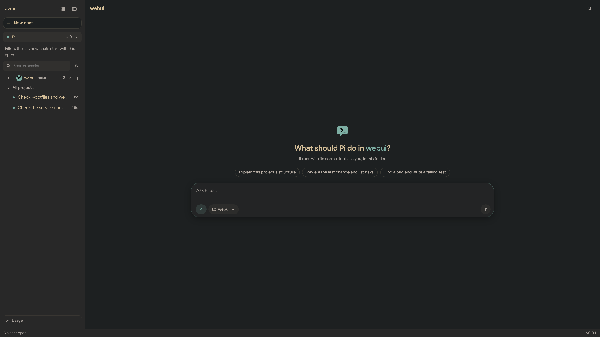
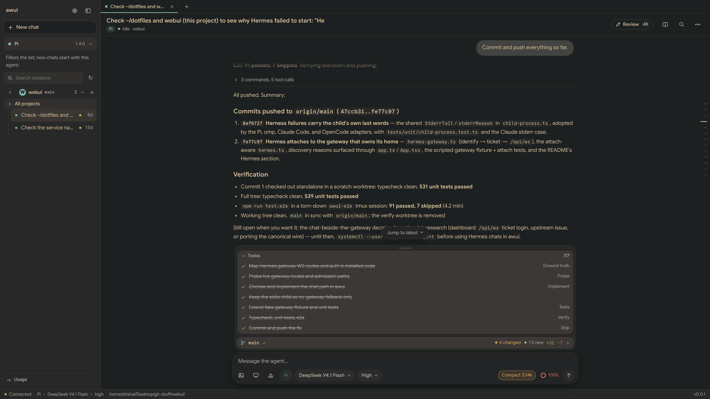
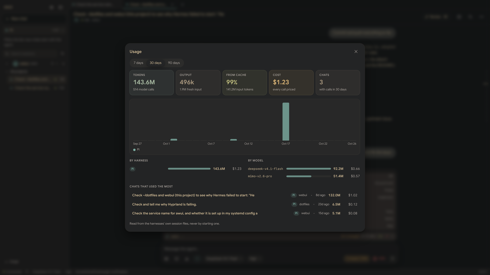
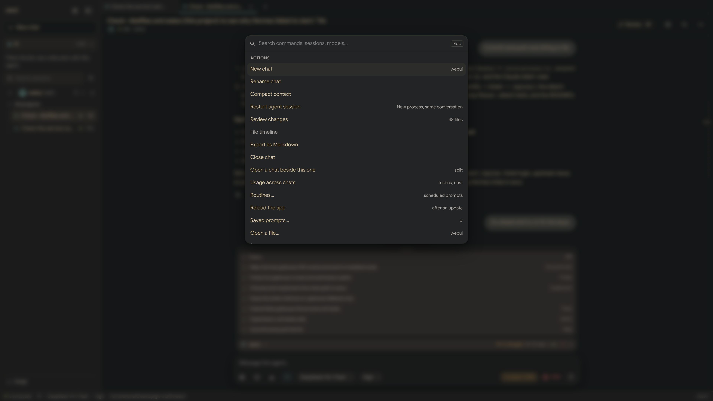
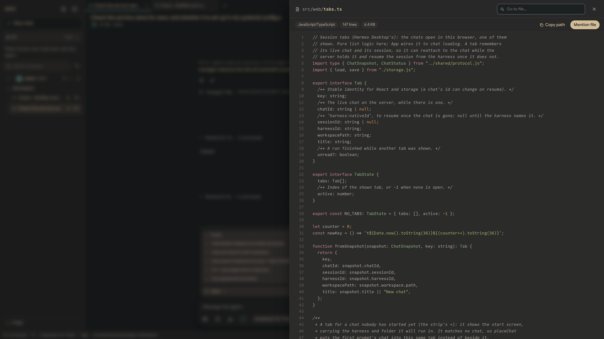
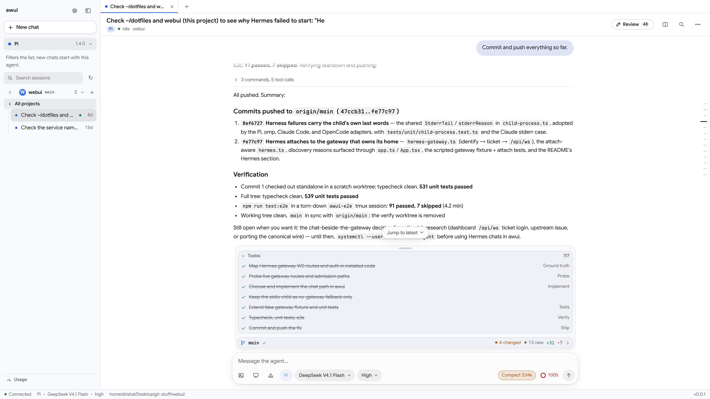
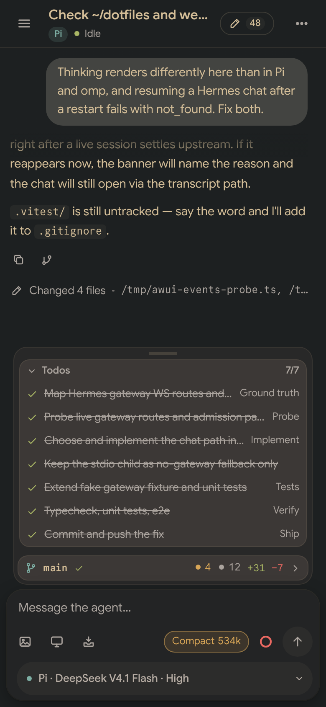
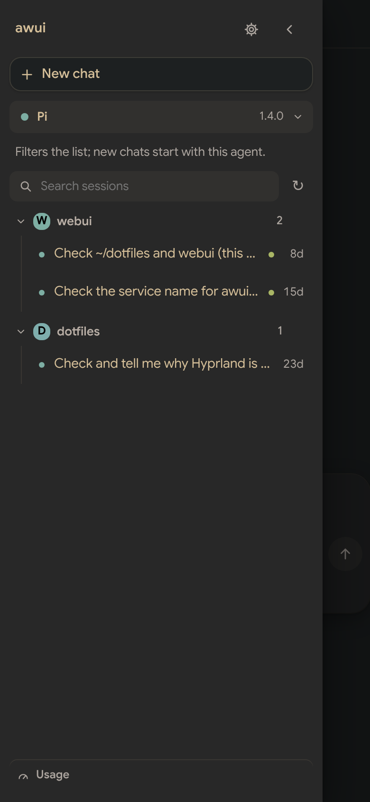
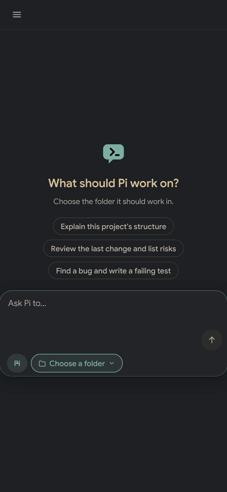

# Screenshots

All of them come from a throwaway `awui` server (port 4799, its own state folder) driving the
real **Pi** harness over two repositories on this machine: `webui` itself and `dotfiles`. The
sessions are real ones, read by awui from Pi's session files — no model was called for the
pictures. The prompts in those copies had their spelling and capitalisation tidied for a
screenshot; the work, the replies, and the numbers are as they happened.

Desktop shots are a 1920×1080 window at 2× (3840×2160 files); the phone ones are 390×844 at 2×.
That is the author's own monitor and theme (`Gruvbox Material`); `light.png` is the same app with
no theme file and a light system appearance.

| | |
|---|---|
|  **Start screen.** A folder chosen, three ways to begin, the composer with the harness and the folder. |  **A turn.** The prompt, the work it took folded to one line — open here: the thought rows, the commands, what each touched. |
|  **A long session.** A finished piece of work — the commits, the tests that passed — beside the todo list it kept and the context ring at 100% with the compact chip. |  **Usage.** Tokens, cache share, cost, and which harness, model, and chat spent them — read from the session files. |
|  **The palette** (Ctrl/⌘-K): actions, settings, and sessions. |  **The file viewer:** a project file, coloured, with *Mention file* into the composer. |
|  **The light palette.** Same chat, `prefers-color-scheme: light`, no theme file. |  **A phone, at the end of the same chat:** the settings chip (`Pi · DeepSeek V4.1 Flash · High`), todos, and the git row above the composer. |
|  **A phone, the drawer:** projects with their monograms and sessions. |  **A phone, the start screen.** |

Regenerating them: run a server on another port with its own `XDG_STATE_HOME` and
`PI_CODING_AGENT_DIR`, open the sessions you want, and drive it with Playwright at
`deviceScaleFactor: 2` (`1920×1080`, and `390×844` for the phone shots); then
`oxipng -o3 --strip safe docs/screenshots/*.png`.
